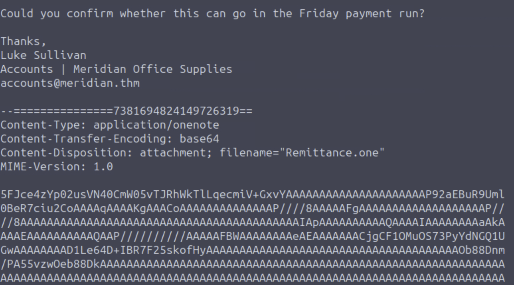
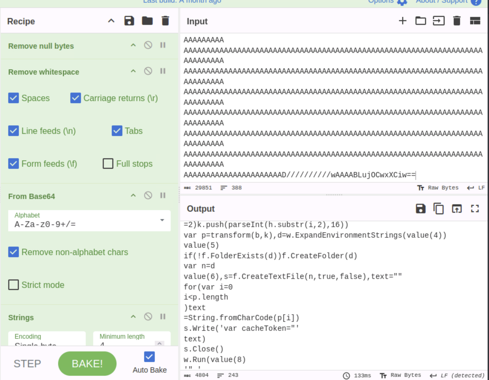
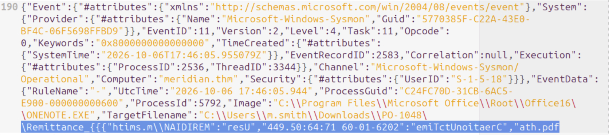
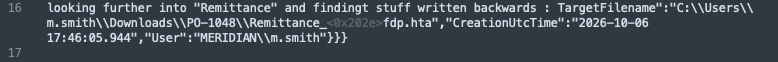
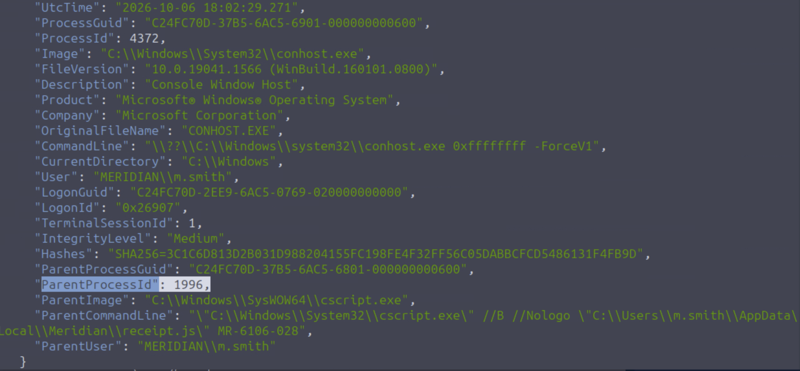
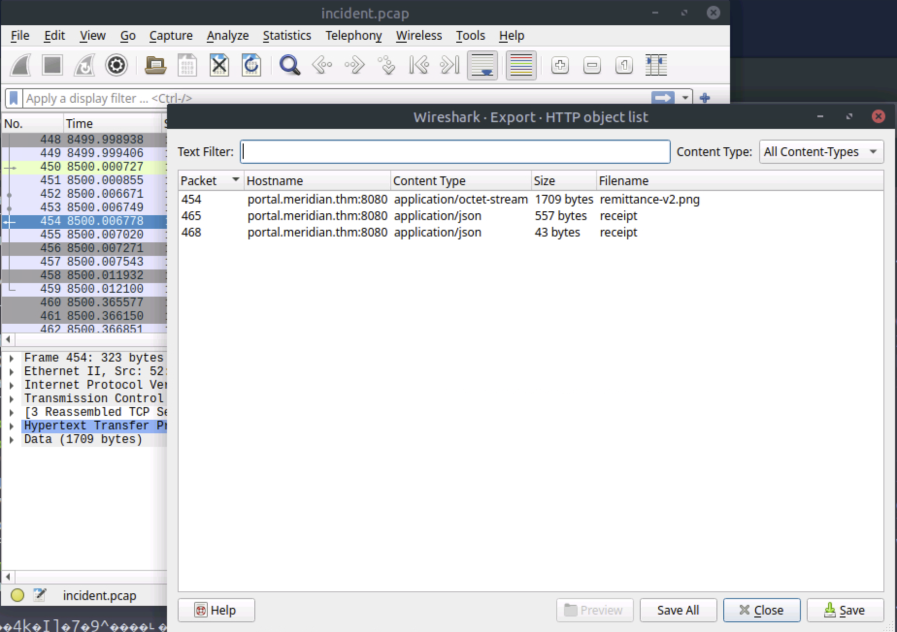
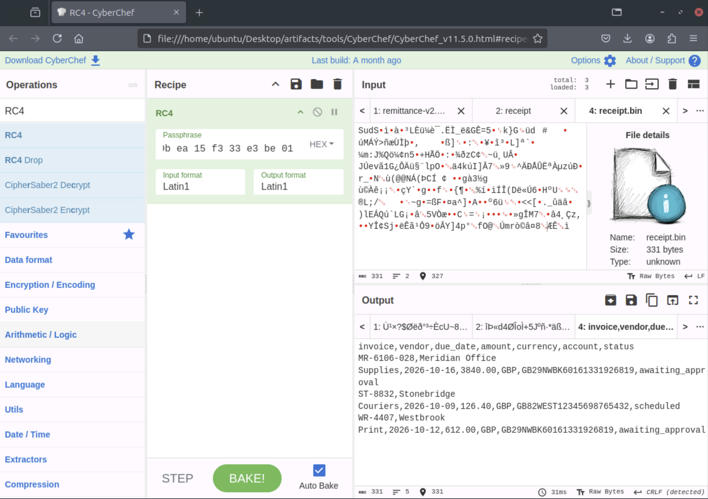

## Introduction

The Waiting Room hands you three artifacts from a compromise at a company called Meridian Office Supplies: a raw phishing email (`vendor.eml`), a Sysmon log converted from `.evtx`, and a network capture (`incident.pcap`). The job is to work out what the email actually delivered, trace it through the host log to execution, and work out what left the workstation. No single tool does this one. It's email headers, an obfuscated JScript block I needed AI help to read, a Unicode trick I'd never run into before, and a stream cipher (RC4) inside that script.

## Theory

A few things came up that I had to look up or confirm before they made sense:

- **Right-to-Left Override (U+202E).** A Unicode character that makes the text from that point on display right-to-left, which can be used to disguise file extensions. I'd never run into this trick before; I only found out what it was by looking up the codepoint mid-room.
- **RC4.** A stream cipher: as the AI assistant described it to me, it turns the key into a keystream and XORs that with the data. The assistant I gave the whole script to named it as RC4.
- **Sysmon event chains.** In this log, each process-create event shows its own `ProcessId` and a `ParentProcessId`/`ParentImage`, and in the `conhost.exe` event, the `ParentProcessId` (1996) is the PID of `cscript.exe`.

## Walkthrough

### Reading the phishing email

`cat vendor.eml` shows a message signed Luke Sullivan, Accounts | Meridian Office Supplies (`accounts@meridian.thm`), asking whether something can go in the Friday payment run. Attached to it, as a MIME part, is `Remittance.one` (`Content-Type: application/onenote`, base64-encoded):



I also ran `shasum -a 256` on the attachment. That hash comes back further down.

### Peeling back the OneNote payload

Pulling the base64 blob from the email into CyberChef, removing null bytes and whitespace, decoding from base64 and running Strings turns the wall of text into a `<script language="JScript">` block: an `entries` array of hex strings, a `value()` function, a `transform()` function and several `ActiveXObject`s. My note at the time: a JavaScript that writes characters to a file in a created folder. I didn't understand more of it yet, and `VBk$` in the output looked like Visual Basic to me, though I wasn't sure:



### Tracing the detonation in Sysmon

I converted the Sysmon `.evtx` to JSON with `evtx_dump`, so I could grep for my hints and use `jq` to get the whole event around a hit. One hit for `Remittance.one` was an event with `m.smith` as the ParentUser and a command line with `ONENOTE.EXE` opening `C:\Users\MC0CD~1.SMI\AppData\Local\Temp\pid-6024\Remittance.one`. There was no process with PID 6024 in the log. The event pointed to the `ONENOTE.EXE` process with a PPID of 4404, which also wasn't present as a PID.

Looking further into "Remittance", I found a file-creation event from `ONENOTE.EXE` with a `TargetFilename` of `C:\Users\m.smith\Downloads\PO-1048\Remittance_<something>fdp.hta`. That's not quite what it reads as on screen. The text after `Remittance_` shows up reversed:



### The Right-to-Left Override trick

Extensions and other parts of file names in other log events were written backwards too, and nothing in the log explained it. My own notes had a `<0x202E>` sitting right before the reversed extensions (`fdp` for `pdf`). I looked it up, and Google's search assist gave me a short explanation: U+202E, Right-to-Left Override, a Unicode character that flips the display direction of the text from that point on. So with `Remittance_<U+202E>fdp.hta`, a viewer that honors the character shows `Remittance_ath.pdf`, which is also how VirusTotal later listed the file, while the stored name still ends in `fdp.hta`:



### From .hta to .js

With an `.hta` file in hand, I looked for `mshta.exe` next. That led me to `cscript.exe //B //Nologo` executing `C:\Users\m.smith\AppData\Local\Meridian\receipt.js`, passed the argument `MR-6106-028`. The event in the screenshot is a `conhost.exe` whose parent is that `cscript.exe`, with a `ParentProcessId` of 1996:



The hostname of the downloaded stage was already in the email header: `portal.meridian.thm`.

### Checking VirusTotal

I'd gotten this far and still couldn't answer the room's questions, and I didn't know why the SHA256 of the mail attachment wasn't recognized. Then I noticed I'd forgotten an important step: VirusTotal. The SHA256 of `Remittance.one` came back flagged by several vendors as `trojan.rlotrick/camelot`, and a related file listed alongside it, `Remittance_ath.pdf`, was labeled `trojan.sload`. That second file's hash `[redacted]` was the actual answer I'd been missing, not the one I started with.

### Looking through the pcap

`incident.pcap` in Wireshark, under **File → Export Objects → HTTP**, lists three objects with the hostname `portal.meridian.thm:8080`: a file named `remittance-v2.png` (`application/octet-stream`, 1709 bytes), and two objects both labeled `receipt` (`application/json`, 557 and 43 bytes):



`file` on the exported `remittance-v2.png` just says "data." It's not an actual image, despite the extension. My note at the time: probably exfiltrated data disguised as an image. `file` calls both receipt objects JSON text. When I read the receipt, though, it looked like binary, so probably encrypted, and that sent me back to the script.

Looking back at this after the next step: the AI assistant's explanation (next section) says the script fetches `remittance-v2.png` with a GET and treats the response as encrypted bytes. So `remittance-v2.png` is the downloaded stage, not exfiltrated data, and my guess about it was off.

### Getting the key from an AI assistant

The script writes a `cacheToken` into a file it drops, and I didn't know JavaScript well enough to work out on my own what that value was or how it got used. I didn't want to run the script: setting up a sandbox for it would be a separate lab, and something worth thinking through. So I gave the script to DuckDuckGo's AI assistant (GPT6-Luna) to get the `cacheToken` without running it. It explained the function to me: the XOR string decoding, a GET request to `remittance-v2.png` whose response the script treats as encrypted bytes, `transform()` as an RC4-style key-scheduling and keystream routine, and the actual `cacheToken` value from the decoded strings. I still didn't fully understand the script, so I asked further questions, and it named the encryption method: RC4, with the `cacheToken` as the key. Its closing advice was to treat the downloaded payload as untrusted and analyze it only statically or in an isolated lab VM.

### Decrypting the receipt with CyberChef

The `data` field in the 557-byte `receipt` object was base64-encoded. Decoding it gave `receipt.bin` (331 bytes), the encrypted receipt data. With the key in hand, CyberChef's RC4 recipe against `receipt.bin`, key entered as hex, gives a readable CSV:



```
invoice,vendor,due_date,amount,currency,account,status
MR-6106-028,Meridian Office Supplies,...,awaiting_approval
ST-8832,Stonebridge Couriers,...,scheduled
WR-4407,Westbrook Print,...,awaiting_approval
```

The SHA256 of that CSV content `[redacted]` was the room's final answer.

## Lessons Learned

- I'd never heard of the Right-to-Left Override trick before this room. The reversed extensions in the log had no explanation until I went back to my own earlier note about the stray codepoint sitting next to them, and I only understood what I was looking at after searching for the codepoint itself.
- I got stuck on an unmatched hash for a while because I skipped VirusTotal entirely at first. Having the hash isn't the same as having checked it against anything.
- I don't know JavaScript well, and I used an AI assistant to help read through the obfuscated script. That's how I got through it, RC4 included.

## Defensive Takeaways

- One detection idea, which I didn't test in the room: flag the U+202E codepoint in a filename. In this log it sits right in the `TargetFilename` of the file-creation event for the `.hta`, well before the `conhost.exe` event in the screenshot.
- Another, also untested: alert on `ONENOTE.EXE` writing an `.hta` file into a user's Downloads folder. That is the file-creation event in the log.
- A third, untested: a mail gateway that looks inside `.one` attachments for embedded script content in addition to hash matching.
- A fourth, untested: `remittance-v2.png` comes back as `application/octet-stream`, and `file` says it is plain "data," not an image. A `.png` like that is something I'd want to look at on the wire.

## References

- [TryHackMe Room — The Waiting Room](https://tryhackme.com/room/thewaitingroom)
- [CyberChef](https://gchq.github.io/CyberChef/)
- [Wireshark](https://www.wireshark.org/)
