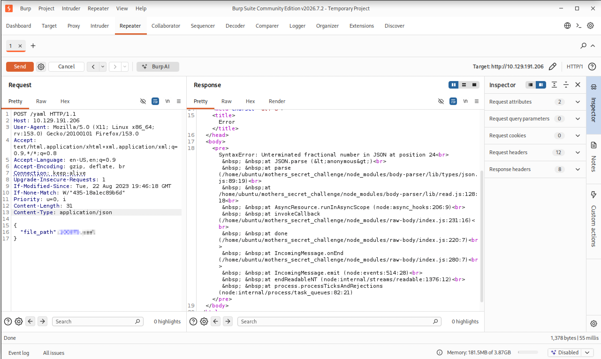
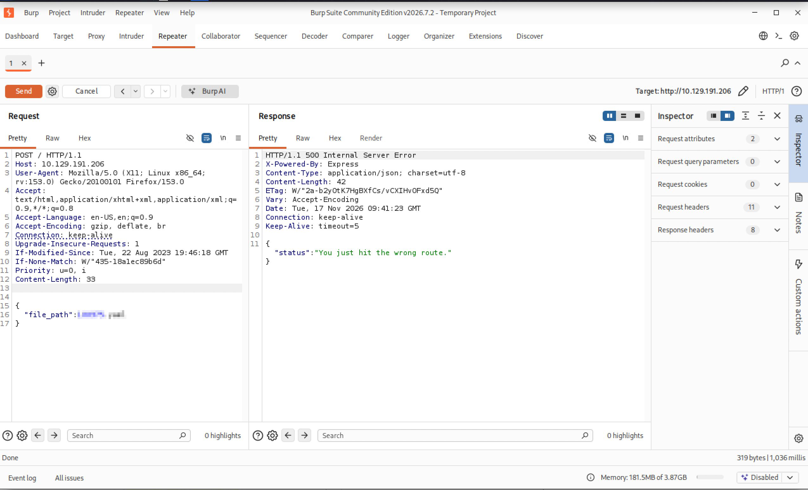
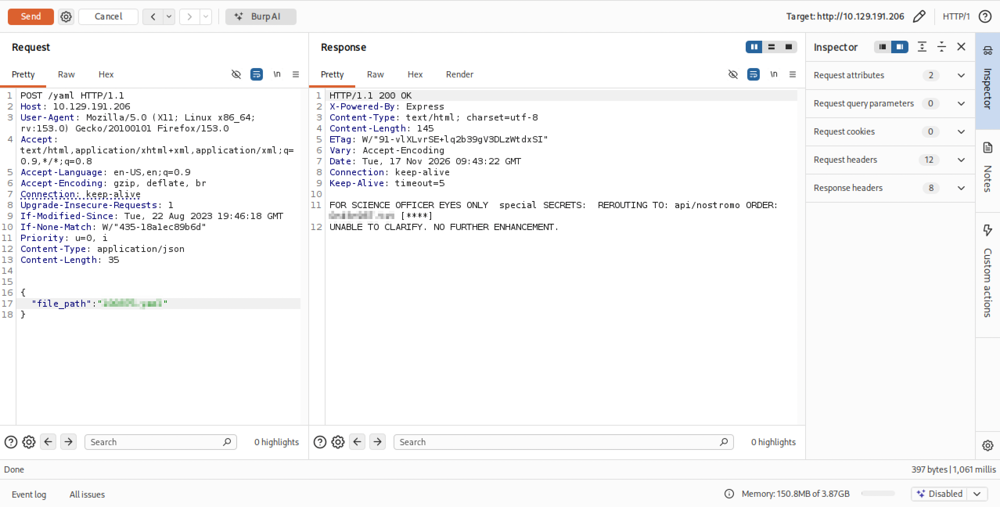
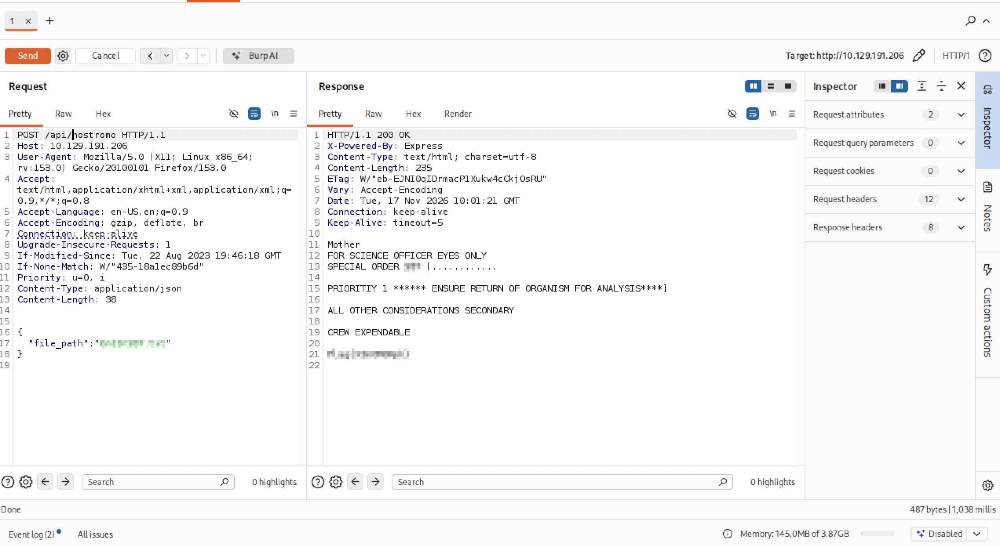
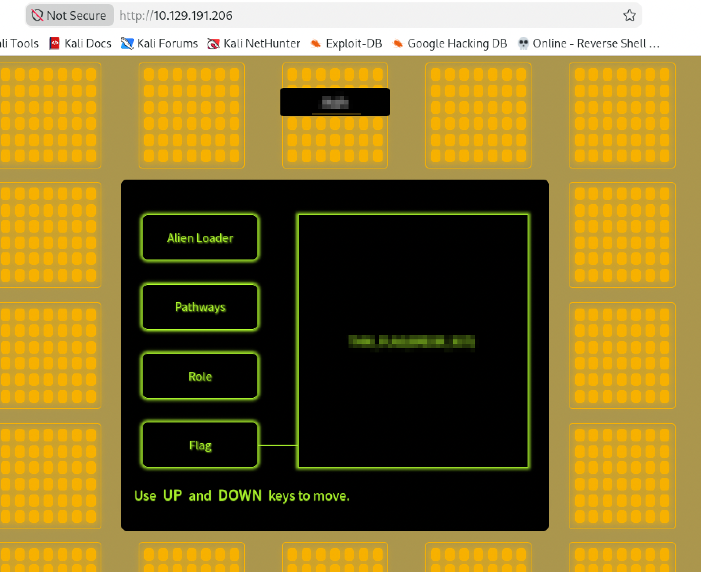
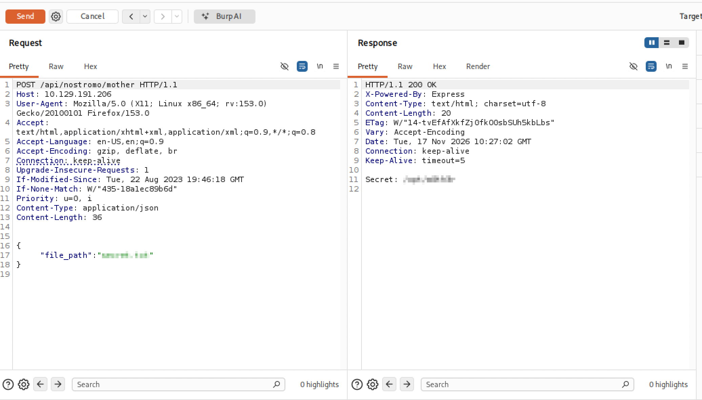
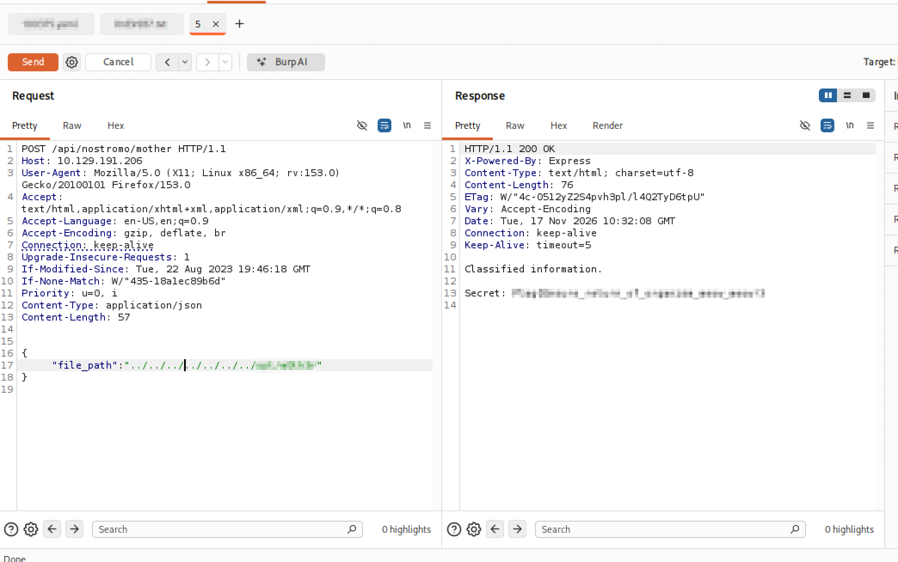

## Introduction

Mother's Secret (rated easy) opens with a target IP and a short block of instructions. The web app behind it is the ship's computer "Mother", and the room asks for seven answers: the override number, the special order number, a hidden flag, the name of the science officer, the contents of the classified "Flag" box, where Mother's secret is, and the secret itself. A task file with the app's API routes comes with it. I skipped the instructions at first because they looked like a free solution, and that cost me a lot of time in this room.

## Theory

Two things I needed for this room:

- **The request format I used.** A POST with a JSON body, `{"file_path": "..."}`, and the header `Content-Type: application/json`.
- **Relative paths and `../`.** The room points out that the routes use relative paths, and the task file shows them building their paths that way. In the last step I used `../` repeatedly to get back to the root directory (I did not work out the mechanism beyond that).

## Walkthrough

### The task file

The room points out that Mother's routes use relative paths, and the task file backs that up. It holds the source of the two route files, and the routes I used in this room all come from it. I put it in a collapsible block, so it is there if you want to read along.

> [!note]- Task file: yaml.js and Nostromo.js
> First `yaml.js`:
>
> ```js
> import express from "express";
> import yaml from "js-yaml";
> import fs from "fs";
> import { attachWebSocket } from "../websocket.js";
>
> const Router = express.Router();
>
> const isYaml = (filename) => filename.split(".").pop() === "yaml";
>
> Router.post("/", (req, res) => {
>   let file_path = req.body.file_path;
>   const filePath = `./public/${file_path}`;
>
>   if (!isYaml(filePath)) {
>     res.status(500).json({
>       status: "error",
>       message: "Not a YAML file path.",
>     });
>     return;
>   }
>
>   fs.readFile(filePath, "utf8", (err, data) => {
>     if (err) {
>       res.status(500).json({
>         status: "error",
>         message: "Failed to read the file.",
>       });
>       return;
>     }
>
>     res.status(200).send(yaml.load(data));
>
>     attachWebSocket().of("/yaml").emit("yaml", "YAML data has been processed.");
>   });
> });
>
> export default Router;
> ```
>
> And `Nostromo.js`:
>
> ```js
> import express from "express";
> import fs from "fs";
> // import { attachWebSocket } from "../../mothers_secret_challenge/websocket.js";
> import { attachWebSocket } from "../websocket.js";
> import { isYamlAuthenticate } from "./yaml.js";
> let isNostromoAuthenticate = false;
>
> const Router = express.Router();
>
> Router.post("/nostromo", (req, res) => {
>   let file_path = req.body.file_path;
>   const filePath = `./public/${file_path}`;
>
>   fs.readFile(filePath, "utf8", (err, data) => {
>     if (err) {
>       res.status(500).json({
>         status: "error",
>         message: "Science Officer Eyes Only",
>       });
>       return;
>     }
>
>     isNostromoAuthenticate = true
>     res.status(200).send(data);
>
>     attachWebSocket()
>       .of("/nostromo")
>       .emit("nostromo", "Nostromo data has been processed.");
>   });
> });
>
> Router.post("/nostromo/mother", (req, res) => {
>
>   let file_path = req.body.file_path;
>   const filePath = `./mother/${file_path}`;
>
>   if(!isNostromoAuthenticate || !isYamlAuthenticate){
>     res.status(500).json({
>       status: "Authentication failed",
>       message: "Kindly visit nostromo & yaml route first.",
>     });
>     return
>   }
>
>   fs.readFile(filePath, "utf8", (err, data) => {
>     if (err) {
>       res.status(500).json({
>         status: "error",
>         message: "Science Officer Eyes Only",
>       });
>       return;
>     }
>
>     res.status(200).send(data);
>
>     // attachWebSocket()
>     //   .of("/nostromo")
>     //   .emit("nostromo", "Nostromo data has been processed.");
>   });
> });
>
> export default Router;
> ```

All three routes take a `file_path` from the request body and put it behind `./public/` or `./mother/`.

### Where I got stuck

The task file lists API routes, so I went looking for directories and pages. Before the first success I tried:

- DirBuster with wordlists of different sizes, to find subpages
- ffuf for fuzzing pages and subdomains, again with several wordlists

None of it led anywhere. In the end I read the first few sentences of another writeup, only to see what I was failing at. The answer was the Operating Manual in the room, which I had skipped. It isn't a solution, but it is meant as the starting point:

```
Operating Manual

Below are some sequences and operations to get you started. Use the following to unlock information and navigate Mother:

Emergency command override is [redacted]. Use it when accessing Alien Loaders.
Download the task files to learn about Mother's routes.
Hitting the routes in the right order makes Mother confused, it might think you are a Science Officer!
```

### Turning the manual into a request

The override number is the key piece, and it belongs to the Alien Loader, which is the YAML part. So my guess was that the file name is the number plus `.yaml`. The first route in the task file talks about a websocket at `/yaml`, so that looked like the real path. I tried it in Burp Suite Repeater.

Because I wanted to name a file, I changed the request from GET to POST and sent a JSON body with a `file_path` value, the number plus `.yaml`.

I forgot the quotes around the value, which gave a JSON syntax error. That error also showed some more paths on the server, which I figured would be useful later. The request also needed the header `Content-Type: application/json`:



A request that doesn't fit gets the same answer every time, "You just hit the wrong route." Here it came back for a POST to `/`, also without the header and without quotes around the value:



With the quotes and the header in place, the same request worked. This was my first success:



The response says "FOR SCIENCE OFFICER EYES ONLY", reroutes me to `api/nostromo` and names an order file, `[redacted]`.

### The order file and the browser

I copied that request over to `/api/nostromo` and set `file_path` to the order file. The response is the special order text, and it contains a flag (`[redacted]`):



That was a dead end for hints. In the browser, though, the crew member name had changed to `[redacted]` and the page now showed a different flag:



### Mother's secret

Below the list in the manual, there is one more line, not in the block above: "Can you guess what is /api/nostromo/mother/secret.txt?" That gave me a target and a `file_path` to try. I sent `secret.txt` to `/api/nostromo/mother`, and the response pointed to a directory under `/opt`, `[redacted]`:



The room had pointed out the relative paths in the routes, so I tried that: a run of `../` in `file_path` to get back to the root directory, followed by the path to that directory. The response is the last flag:



## Lessons Learned

- This was a hard room for me because I never found the start. My biggest mistake was ignoring the Operating Manual and spending a long time with DirBuster and ffuf instead.
- My offensive skills aren't very strong yet. What got me moving was a small nudge from another writeup, which I read only at the beginning to see why I was stuck.
- The JSON syntax error was useful in a way I didn't expect: it showed server paths I hadn't asked for.

## Defensive Takeaways

- One idea, which I didn't test in the room: in the last step the `file_path` value carried `../` and was accepted as sent. A check that rejects `..` in it might have stopped that step.
- The syntax error in the first screenshot returned a stack trace with server paths. Returning a short generic error instead would give less away.
- In this room the first successful response told me the next route and the order file by name. I'd guess answering with less detail would have made the next step harder. Untested.

## References

- [TryHackMe Room — Mother's Secret](https://tryhackme.com/room/codeanalysis)
- [Burp Suite Community Edition](https://portswigger.net/burp/communitydownload)
- [ffuf](https://github.com/ffuf/ffuf)
- [OWASP DirBuster](https://wiki.owasp.org/index.php/DirBuster)
